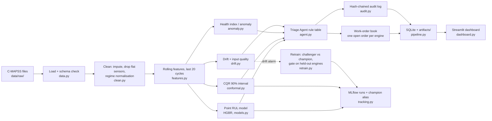
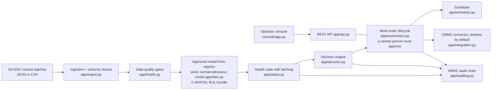

# SentinelLoop: project handover guide

This guide is for anyone picking up SentinelLoop without its authors in the room: a developer, a teammate, an evaluator or a technical reviewer. It explains:
- what we built, and why;
- how it works and how to run it;
- what we measured;
- what is still missing.

Every number here comes from a file in the repository, and the source is named next to it. Where an example is made up for teaching, it says so.

> **The one thing to remember.** SentinelLoop is a working, well-tested **prototype**. Every result comes from **simulated or synthetic data**: NASA's simulated jet engines, and a wind-turbine data generator we wrote ourselves. It has never been run on a real customer's machines, never met a maintenance team, and saved no one any money yet. It is not production-ready and not a safety system.

---

## Contents

- A. [Start here: what is SentinelLoop?](#a-start-here-what-is-sentinelloop)
- B. [Why we built it this way](#b-why-we-built-it-this-way)
- C. [How the complete system works](#c-how-the-complete-system-works)
- D. [Repository map](#d-repository-map)
- E. [Setup and run the project from scratch](#e-setup-and-run-the-project-from-scratch)
- F. [How the machine-learning pipeline works](#f-how-the-machine-learning-pipeline-works)
- G. [The decision engine and work-order workflow](#g-the-decision-engine-and-work-order-workflow)
- H. [Monitoring, retraining and auditability](#h-monitoring-retraining-and-auditability)
- I. [Experiments, results and lessons learned](#i-experiments-results-and-lessons-learned)
- J. [Tests and verification status](#j-tests-and-verification-status)
- K. [Known limitations and risks](#k-known-limitations-and-risks)
- L. [How to continue development](#l-how-to-continue-development)
- M. [Glossary and quick reference](#m-glossary-and-quick-reference)

---

## A. Start here: what is SentinelLoop?

### In one paragraph

Machines wear out. If you repair them too late, they break while running: unplanned downtime, possibly damage or danger. If you repair them too early, you waste parts, labour and useful machine life.

**Predictive maintenance** tries to hit the middle. It watches sensor data and estimates how close each machine is to failure, so repairs are planned at the right time.

SentinelLoop does that, and then goes one step further. It turns the estimate into a **maintenance decision** a person can act on:
- *do nothing*;
- *keep watching*;
- *plan maintenance*;
- *inspect now*, or *send this to a human because the evidence is not trustworthy*.

It records every decision so it can be checked later.

### Who would use it

| user | the question they ask | what SentinelLoop gives them |
|---|---|---|
| Maintenance planner | Which machines need work, and how soon? | A prioritised list of draft work orders with due dates and reasons |
| Reliability engineer | Is this alarm real, or is the data bad? | The model's estimate with an uncertainty range, the sensors that moved most, and explicit "escalate to a human" flags |
| Technician | What do I do, and why? | A job card with the reason and the evidence |
| Auditor or reviewer | Why did the system say that last Tuesday? | A tamper-evident record from which every decision can be re-computed |

### Two things live in this repository

You need to know this from the start, because the folders follow it.

1. **The competition pipeline** (`src/sentinelloop/*.py`, `experiments/`, `docs/`, `submission/`). We built it first, for **Tata Elxsi TELIPORT Season 4, Case Study 1** ("Self-Healing Machines: Predictive Maintenance for a Connected Fleet"). It works on NASA's simulated turbofan engines (C-MAPSS). It runs in a few steps:
   - predict Remaining Useful Life with an uncertainty interval;
   - apply a rule-based "Triage Agent";
   - produce draft work orders;
   - write an audit log;
   - track runs in MLflow;
   - retrain through a promotion gate.

   It is **frozen**: kept as submitted, tag `competition-baseline`.
2. **The product platform** (`src/sentinelloop/app/`, `src/sentinelloop/console/`, `product/`). This is the same idea rebuilt as a maintenance-decision service with:
   - a REST API and a database;
   - a full work-order lifecycle with human approval, and a scheduler;
   - a connector to a maintenance-management system (CMMS);
   - an operator console.

   Its first target asset is the wind turbine. It was developed in Phases 0–10 on branch `product/platform`. Its handoff document is `product/FINAL_PRODUCT_HANDOFF.md`.

They share ideas, not much code. The platform's C-MAPSS model bundle reuses the competition's model code (`src/sentinelloop/app/modelpack.py`). Retraining, drift monitoring and the batch pipeline exist **only** in the competition code (README, "Competition-pipeline-only capabilities").

### More than an RUL model

Plenty of projects predict **Remaining Useful Life (RUL)**: how many more operating cycles a machine has before it fails. A number alone is not a decision. SentinelLoop adds:
- **an uncertainty range** around each prediction, and a decision rule that uses its pessimistic end;
- **data-quality and drift checks**, so bad or unfamiliar input leads to "ask a human", not a confident wrong order;
- **an explicit rule table**, so a person can read exactly why a decision was made;
- **an audit trail**, from which every decision can be re-derived and tampering detected;
- **gated retraining**, so a new model replaces the old one only if it passes checks;
- in the platform, **human approval** of every work order, plus warnings that "latch" (stay on until someone actually inspects).

### One machine, from sensors to decision (real output, simulated data)

This row comes from a quick demo run we made while writing this guide:
- the command was `python -m sentinelloop run --subset FD001 --fast --stream-units 2 --no-mlflow --out-dir <scratch>`;
- the output file is `decisions_test.csv`;
- the engines are NASA's simulated ones.

1. **Sensors.** Test engine 24 of FD001 has been running for 186 cycles. We see its 21 sensor readings and 3 operating settings for every cycle so far. Nobody knows when it will fail.
2. **Cleaning and features.** Readings are cleaned and scaled. For each sensor we compute the mean, spread and trend over the last 20 cycles.
3. **Health check.** Its anomaly score is 11.2, which is above the healthy threshold. The sensors that moved most are `s14` (its rolling spread and trend) and `s9`.
4. **RUL prediction.** The point estimate is 32.9 cycles left. The 90% interval runs from 18.9 to 117.6.
5. **Decision.** The rule table looks at the **lower** end of the interval, 18.9. That is at or below the "high" threshold of 25 cycles, so severity is **HIGH** and the action is **SCHEDULE_MAINTENANCE**. Data quality is fine and no drift was detected, so it is not escalated.
6. **Work order.** A maintenance order is created, carrying the estimate, interval, top sensors, the rule that fired (`R_HIGH`) and the model version.
7. **Audit.** The decision and its inputs go into a hash-chained log.
8. **What actually happened.** We know this only because the data are simulated: the engine's true remaining life was 20 cycles. The order was timely.

A second engine in the same run, engine 20, shows the safety valve. Its lower bound was 7.0, so severity is CRITICAL. But its interval was very wide (7 to 118), wider than the model's calibrated width limit. So the decision became **INSPECT, escalated to a human** with reason `insufficient_evidence`, not "stop and repair".

### What it can show today, and what it cannot

| can show today | cannot show yet |
|---|---|
| The whole loop runs end to end on simulated engines, reproducibly | That it works on any real machine |
| Benchmark accuracy on the NASA data, with honest evaluation | That those accuracy numbers carry over to real fleets |
| Bad input is caught and escalated in simulated stress tests | Behaviour on real sensor faults |
| Every decision can be re-derived from the audit log | Acceptance by real maintenance staff |
| A platform with approval, scheduling and a CMMS connector, tested against test doubles | That it works with a real CMMS. The Odoo test has not been run |
| Wind anomaly detection on synthetic turbines | Detection or false-alarm rates on real turbines. The pre-registered test on public data is waiting for download approval |

---

## B. Why we built it this way

Each decision below is recorded with its evidence:
- competition decisions (D1–D26) in `docs/DECISION_LOG.md`;
- product decisions (PD-01–PD-28) in `product/DECISION_LOG.md`.

### Why Case Study 1

We compared the five case studies, which are the PDFs in the repository root. The comparison is in `analysis/` and `docs/PROBLEM_SELECTION.md`. Case 1 was confirmed after an independent re-check (D2). Three reasons:
- it has a strong public benchmark;
- it could be built and evaluated honestly on a laptop;
- its "closed loop" requirement left room for a real decision layer, not just a model.

The case study's ground rule was **no LLM**, and that shaped later choices.

### Why NASA C-MAPSS, and what it represents

**C-MAPSS** is NASA's simulated turbofan-engine degradation dataset (Saxena et al., PHM08). It has four subsets:

| subset | operating conditions | fault modes |
|---|---|---|
| FD001 | 1 | 1 |
| FD002 | 6 | 1 |
| FD003 | 1 | 2 |
| FD004 | 6 | 2 |

- **Training engines** run until they fail.
- **Test engines** stop at an unknown point, and the true remaining life is given separately.
- It is the standard public benchmark for RUL, so results can be compared with the literature.
- **Its limits:** it is simulated, it is clean in ways real data are not, and it describes jet engines, not a customer's equipment.

We download it with a checksum check and do not redistribute it, because the licence is not specified (D7; `src/sentinelloop/data.py`).

### Why cleaning and rolling-window features

Raw sensor readings are noisy, and in FD002 and FD004 they jump whenever the operating condition changes. Two things make the signal usable:
- **Regime normalisation:** group rows by operating condition (KMeans on the three settings) and scale sensors within each group. Evidence: FD004 RMSE 15.54 with it, 17.95 without (D14).
- **Rolling features:** mean, spread and trend over the last 20 cycles. In the ablation, raw sensors only gave RMSE 17.75 against 15.05 for the full feature set on FD001, and 18.24 against 16.55 on FD004 (E7).

Every feature looks **backwards only**. That keeps the system honest: it cannot use information from the future. It also lets stream replay produce bit-identical features (D23).

Something we tried and switched off: smoothing (EMA denoising). It helped FD001 slightly but cost 6–7 RMSE on FD004, because it lags the degradation signal. It stays available but off (D13, E7).

### Why the current RUL model

The model is scikit-learn's **HistGradientBoostingRegressor** (gradient-boosted trees). We chose it because it:
- is fast on a CPU;
- retrains in minutes;
- beat a RandomForest on most subsets;
- has no fragile dependencies. LightGBM crashed on our machine, and deep models were not needed for the evidence we wanted (D5).

Baselines are in `docs/NUMBERS.md` (E0):

| model | RMSE against capped truth (FD001–FD004) |
|---|---|
| naive mean | 41.9–45.6 |
| RandomForest | 14.6–16.2 |
| HGBR | 13.6–15.2 |

We do not claim it is the best possible model. It is a solid, explainable one.

### How the health and anomaly check works

The detector learns "normal" from the first 40% of each training engine's life: the mean and spread of every feature. A row's **anomaly score** is the root-mean-square of its two largest standardised deviations. A flag counts only if it persists for 3 cycles (`configs/default.yaml`, `anomaly:`). It reports which sensors moved most, which is what makes it explainable.

We also tried IsolationForest. It never flagged anything in a test with about 60 features, so it is kept only as an ablation option (D10).

### Why prediction intervals, and how their limits are stated

A single RUL number hides how unsure the model is. We use **conformalized quantile regression (CQR)**:
1. Two extra models predict a low and a high quantile.
2. 30% of the *training engines* are held out to measure how often those bounds miss.
3. The bounds are widened until a 90% interval is reached on that held-out set.

**The limitation, stated wherever intervals appear:** coverage is *marginal*. It holds on average over engines, under an assumption that test engines resemble the calibration engines. It is not guaranteed for each engine, and it is lower where it matters most:
- FD004 test set: 0.85;
- near failure (true RUL 25–50 cycles): 0.81–0.87 (`product/evidence/calibration/c1.md`);
- against the raw, uncapped truth: 0.58–0.87.

So we never call the intervals "calibrated" without that qualifier.

### Why the Triage Agent is a rule table, not an LLM

Three reasons:
- the case study banned LLMs;
- maintenance decisions need to be explainable and repeatable;
- an LLM's output cannot be re-derived exactly from its inputs.

The "agent" (`src/sentinelloop/agent.py`) is about 40 lines of explicit rules with named rule ids. Its thresholds live in `configs/default.yaml`. Every decision stores its inputs and the rules that fired, which is what makes the audit re-derivation possible.

### Why MLflow, versioning, monitoring and gated retraining

| choice | why |
|---|---|
| **MLflow** (`src/sentinelloop/tracking.py`), on a local SQLite backend with registry *aliases* (`champion`), not deprecated stages (D6) | Every run's parameters, metrics and model are recorded |
| **Drift monitoring** (`src/sentinelloop/drift.py`) | Detects when incoming data no longer look like the training data. It compares early-life rows with the same age slice of training engines (D17), because comparing old engines with young ones would always look like drift |
| **Gated retraining** (`src/sentinelloop/retrain.py`) | A new "challenger" model replaces the "champion" only if it passes three checks on held-out engines: error, interval coverage and late-order rate. A rejection is logged with reasons, so the reject path is as visible as the accept path |

### Why audit records and human escalation

- If a maintenance decision is questioned later, you need to show exactly what the system saw and why it acted.
- If the evidence is weak (bad data, unfamiliar conditions, a very wide interval, conflicting signals), the honest output is "a person should look", not a guess.

That is why escalation and the audit trail are first-class features, not add-ons.

### What we tried, what worked and what did not

All experiments were pre-registered in `docs/EXPERIMENT_PLAN.md` and reported in `docs/EXPERIMENT_RESULTS.md`, including the failures. The short version is in section I.
- **Several hypotheses were NOT SUPPORTED, and we kept them in the record:** the lower-bound policy being "better" (H1), abstention reducing errors (H2), and the retraining gate selectivity (H4).
- **They changed the design:** the lower-bound rule is presented as a *conservative operating point that costs 11–15 cycles of life*, not as an improvement.

---

## C. How the complete system works

### Competition pipeline (C-MAPSS)



Step by step, for one `python -m sentinelloop run --subset FD001`:

1. **Load and validate** the training and test files and the true-RUL file (`data.py`).
2. **Clean** (`clean.py`). Everything here is fitted on training data only:
   - impute missing values, with a flag recording that it happened;
   - drop sensors that never vary;
   - normalise per operating regime.
3. **Features** (`features.py`): rolling mean, standard deviation and slope over 20 cycles.
4. **Models** (`models.py`, `conformal.py`):
   - a point model trained on all training engines, for the headline RMSE;
   - a second point model plus quantile models trained on 70% of the engines, with the other 30% calibrating the interval. The agent uses this second model, so its interval is honest.
5. **Health and drift** (`anomaly.py`, `drift.py`): anomaly score and flag per row, fleet drift alarm, and a per-window input-quality flag.
6. **Triage** (`agent.py`): severity from the interval's lower bound, plus escalation checks (section G).
7. **Work orders** (`WorkOrderBook` in `agent.py`):
   - at most one open order per engine;
   - severity can only go up;
   - the due date can only move earlier.
8. **Audit** (`audit.py`): each decision is appended to `artifacts/audit/decisions_<subset>.jsonl` with a hash linking it to the previous one.
9. **Store** the outputs: SQLite `artifacts/sentinelloop.db`, CSV and JSON files in `artifacts/<subset>/`, and MLflow.
10. **Stream replay** (`stream.py`): the first N test engines are replayed cycle by cycle, and must give the same decisions as batch (tested).
11. **Retraining** is a separate command (section H).

### Product platform (wind turbines, and C-MAPSS as a demo type)



The platform does not retrain or monitor drift. Those exist only in the competition pipeline.

---

## D. Repository map

Generated from the actual tree. "Modify?" says whether a new developer would normally change it.

| path | what it is | why it exists | modify? |
|---|---|---|---|
| `README.md` | Front door: product status banner, then the competition history | First thing anyone reads | Rarely |
| `PROJECT_HANDOVER_GUIDE.md` | This guide | Onboarding | Keep it current |
| `pyproject.toml`, `requirements.lock.txt`, `requirements-platform.txt` | Package definition; pinned full environment; smaller platform-only set | Reproducible installs | Only when changing dependencies |
| `Makefile` | Shortcuts for common commands | Convenience | Rarely |
| `configs/default.yaml`, `configs/FD00x.yaml` | Every competition-pipeline threshold, with per-subset overrides (FD002 and FD004 use 6 regimes) | One place for settings; a config hash is logged with each run | **Yes, carefully.** Changes move results (section L) |
| `configs/platform.yaml` | Platform assessment policy: data-quality limits, state thresholds, per-asset-type settings | Platform behaviour | Carefully |
| `configs/decision.example.yaml` | Example site decision parameters (placeholders) | Template for a site | Copy it, don't edit it |
| `src/sentinelloop/data.py` … `stream.py` | Competition pipeline modules (section C) | The benchmark system | Frozen. Change only with a reason, and re-run the experiments |
| `src/sentinelloop/cli.py`, `__main__.py` | `python -m sentinelloop …` commands | Entry point | When adding a command |
| `src/sentinelloop/dashboard.py`, `viewdata.py` | Competition Streamlit dashboard (reads `artifacts/`) | Demo and inspection | Rarely |
| `src/sentinelloop/app/` | Product platform: `api.py`, `admin.py` (CLI), `ingest.py`, `health.py`, `states.py`, `decision.py`, `workorders.py`, `scheduler.py`, `planning.py`, `integration.py`, `auditlog.py`, `nbm.py` (wind model), `synthetic_wind.py`, `sim.py` (fleet simulator), `migrations/0001–0009` | The product | **Yes**, this is where development continues |
| `src/sentinelloop/console/` | Operator console (Streamlit client of the API) | Human interface | Yes |
| `tests/` | 54 test files: competition tests (`test_agent.py`, `test_audit.py`, …) and platform tests (`test_app_*.py`, `test_console.py`) | Safety net | Add tests with every change |
| `experiments/` | Competition experiments E0–E7, `run_all.py`, `numbers_digest.py`; results in `experiments/results/` | The evidence behind every competition number | Add new experiments; don't edit finished ones |
| `product/experiments/` | Platform experiments: S1/S2 scheduling, W1–W3 wind, C1/C2 calibration, L1 load, R1 recovery | Product evidence | As above |
| `product/evidence/` | Outputs of those experiments, test logs, API spec, demo checks, the G0 pre-registration | Proof for claims | Generated; regenerate, don't hand-edit |
| `product/*.md` | Product documents: requirements, architecture, decision log, claim–evidence matrix, known limitations, pilot protocol, handoff | Product record | Yes, keep them in sync with the code |
| `docs/` | Competition documents (design, experiment plan and results, numbers digest, red-team review) | History | Frozen |
| `submission/` | Round 1 slide, Round 2 deck, competition claim matrix | What was submitted | Frozen |
| `analysis/`, `research/` | Case-selection study; prior-art and market research | Background | Read-only |
| `sandbox/odoo/` | Local Odoo kit to test the CMMS connector | Integration test (not yet run) | When working on the CMMS connector |
| `data/raw/` *(git-ignored)* | The C-MAPSS files after download | Input | Never commit |
| `artifacts/` *(git-ignored)* | Outputs of the last full competition run: models, predictions, decisions, audit logs, SQLite, MLflow | Generated | Regenerated by `run` / `run_all.py` |
| `artifacts_demo/`, `backups/`, `mlruns/`, `artifacts_pre_phase6/` *(local)* | Demo site; backup zip of the competition state; older run outputs | Local working state | No |
| `Case Study *.pdf` | The five TELIPORT case studies | Problem statement | No |
| `PROJECT_STATUS.md`, `FINAL_HANDOFF.md` | Competition-era status and handoff | History | No |

---

## E. Setup and run the project from scratch

Tested on Windows 11 with Python 3.12.1. The commands use the Windows virtual-environment path `.venv/Scripts/python.exe`; on Linux or macOS use `.venv/bin/python`. Run everything from the repository root.

### First-run checklist

1. Create the environment and install (below).
2. Download and verify the data, then run `doctor`.
3. Run the **quick demo** into a scratch folder.
4. Run the **audit** on that folder.
5. Run the tests.
6. Read section I and `product/KNOWN_LIMITATIONS.md` before trusting any number.

### 1. Environment (one time)

```bash
python -m venv .venv
```
```bash
.venv/Scripts/python.exe -m pip install -r requirements.lock.txt
```
```bash
.venv/Scripts/python.exe -m pip install -e . --no-deps
```

`requirements.lock.txt` is the full pinned environment, including MLflow and Streamlit. If you only want the product platform, use `requirements-platform.txt` instead (see `product/DEPLOYMENT_GUIDE.md`).

### 2. Data and environment check

```bash
.venv/Scripts/python.exe -m sentinelloop data --download
```
```bash
.venv/Scripts/python.exe -m sentinelloop doctor
```

- `data --download` fetches the NASA archive and checks its checksum.
- **Expected `doctor` output** (verified for this guide): the Python and package versions, "all 12 C-MAPSS files present", both archive checksums OK, and `doctor: OK`.

### 3. Quick demo (about 10 seconds; verified for this guide)

Use `--out-dir` so you do not overwrite the shipped results in `artifacts/`:
```bash
.venv/Scripts/python.exe -m sentinelloop run --subset FD001 --fast --stream-units 2 --no-mlflow --out-dir scratch_demo
```

- **Expected:** "done in ~6.5 s: HGBR RMSE 14.54 capped / 15.84 raw, PICP 0.910 …, orders 23, escalation share 0.13".
- `--fast` uses a smaller model, so these numbers differ slightly from the full-run numbers in section F.
- Outputs land in `scratch_demo/FD001/` (`decisions_test.csv`, `work_orders.json`, `metrics.json`, …) and `scratch_demo/audit/`.

### 4. Verify the audit trail (verified)

```bash
.venv/Scripts/python.exe -m sentinelloop audit --out-dir scratch_demo
```

- **Expected:** a JSON report with `"mismatches": 0` and `"chain_valid": true`.
- On the demo folder it re-derived 180 decisions.
- Without `--out-dir` it checks the shipped full-run logs: 3,409 decisions (E6).

### 5. Retraining demo (verified)

```bash
.venv/Scripts/python.exe -m sentinelloop retrain --subset FD001 --simulate-new-data --fast --no-mlflow --out-dir scratch_demo
```

- It needs a previous `run` into the same `--out-dir`.
- `--simulate-new-data` treats training engines the champion never saw as "new data".
- **Expected:** a JSON report with `"decision": "PROMOTE"` or `"REJECT"` and the gate reasons, written to `scratch_demo/FD001/retrain_log.json`. Our check gave PROMOTE.
- Other options: `--new-data <file>` for a real C-MAPSS-format file; `--only-if-drift` to retrain only after a recorded drift alarm.

### 6. Full pipeline and dashboard

```bash
.venv/Scripts/python.exe -m sentinelloop run --subset all
```
```bash
.venv/Scripts/python.exe -m sentinelloop dashboard
```

> **Warning.** `run` without `--out-dir` **overwrites** `artifacts/<subset>/` and deletes that subset's stored decisions and audit log (`product/TECHNICAL_DEBT.md` B2).

- The full run took about 36–45 s per subset in the last recorded run (`docs/NUMBERS.md`, "elapsed s").
- The dashboard reads `artifacts/` and needs a run first. It answered HTTP 200 in the Phase 0 check (`product/evidence/phase0/phase0_checks.log`); it was not re-launched for this guide.
- MLflow UI: `.venv/Scripts/python.exe -m mlflow ui --backend-store-uri sqlite:///artifacts/mlflow.db`

### 7. Reproduce all competition experiments (long)

```bash
.venv/Scripts/python.exe experiments/run_all.py
```
```bash
.venv/Scripts/python.exe experiments/numbers_digest.py
```

- `run_all.py` runs the E0 baseline, the pipeline on all subsets, E1–E7 and the seed check.
- The last full run took about 55 minutes (`experiments/results/run_all_phase6.log`). `--fast` and `--skip-baseline` exist for shorter runs.
- It **overwrites** `artifacts/` and `experiments/results/`.
- `numbers_digest.py` regenerates `docs/NUMBERS.md`. Quote numbers from there, never from memory.

### 8. Product platform demo (API and console)

Verified on 2026-10-18 and recorded in `product/evidence/demo/local_demo_check.md`. It uses synthetic wind data. Create the folder and a demo audit key (once):
```bash
mkdir -p artifacts_demo
```
```bash
python -c "import secrets; print('SENTINELLOOP_AUDIT_KEY=' + secrets.token_hex(32))" > artifacts_demo/demo_key.env
```

Build the demo site:
```bash
set -a; . artifacts_demo/demo_key.env; set +a; PYTHONPATH=src .venv/Scripts/python.exe product/scripts/demo_site.py artifacts_demo/console
```

Start the API (127.0.0.1:8080):
```bash
.venv/Scripts/python.exe product/scripts/run_demo_api.py
```

Start the console:
```bash
.venv/Scripts/python.exe -m streamlit run src/sentinelloop/console/app.py
```

- The key and build commands use bash syntax (Git Bash on Windows).
- Sign in with a key from `artifacts_demo/console/demo_credentials.json`.
- Production-style setup is in `product/DEPLOYMENT_GUIDE.md` and `product/OPERATIONS_RUNBOOK.md`.

### 9. Tests

The full suite:
```bash
.venv/Scripts/python.exe -m pytest tests -q
```

Platform tests only (works in PowerShell too):
```bash
.venv/Scripts/python.exe -m pytest tests -k "test_app_ or test_console"
```

27 tests need the C-MAPSS files or the out-of-fold table from `run_all.py`, and they skip without them. Results are in section J.

### Common setup failures

| symptom | fix |
|---|---|
| `import streamlit` fails on the system Python | Use the venv (a plotly 4.x install breaks Streamlit) |
| MLflow `ImportError … FallbackAsyncAdaptedQueuePool` | SQLAlchemy 2.1 is incompatible; the lock file pins 2.0 (D12) |
| data.nasa.gov unreachable | The download uses NASA's S3 mirror with a checksum; keep `data/raw/` once fetched |
| Dashboard shows nothing | Run `python -m sentinelloop run --subset FD001` first |
| Glob test command fails in PowerShell | Use the `-k "test_app_ or test_console"` form |
| `echo … > artifacts_demo/…` fails | Create `artifacts_demo/` first (it is git-ignored) |

---

## F. How the machine-learning pipeline works

### The data

- Each row is one engine at one cycle: unit id, cycle number, 3 operating settings and 21 sensors.
- Training engines run to failure, so the target is simply **RUL = last cycle − current cycle**.
- RUL is **capped at 125**. Early in life degradation cannot be seen, so the literature treats "more than 125" as "125" (`targets.py`).
- We always report metrics against **both** the capped and the raw truth, because the capped version flatters the model.

### Keeping training, calibration and test apart (avoiding leakage)

**Leakage** means information from the test answer sneaking into training, which makes results look better than they are. We guard against it in five ways:
- Cleaning and scaling are fitted on training data only (`clean.py`).
- Features look backwards only.
- Interval calibration uses **whole engines** held out from training (30%), never rows of an engine the model trained on.
- Cross-validation splits by engine. We showed how much the wrong protocol flatters results: scoring only each engine's last cycle in validation reports RMSE 2.5–6.9, against an honest 12.4–16.6 with random truncation (E0, `docs/NUMBERS.md`).
- **Official test protocol:** predict at each test engine's last observed cycle and compare with `RUL_FD00x.txt` (D8).

### Training and evaluation

The headline model is HGBR trained on all training engines. The agent's model is trained on 70% of them, with the other 30% calibrating the interval.

Full run, 2026-10-18, simulated data (`docs/NUMBERS.md`):

| subset | RMSE capped / raw (headline model) | RMSE capped (agent's model) | 90% interval coverage, capped / raw | mean interval width |
|---|---|---|---|---|
| FD001 | 14.17 / 15.37 | 14.75 | 0.94 / 0.87 | 64 |
| FD002 | 14.92 / 26.99 | 15.23 | 0.89 / 0.67 | 66 |
| FD003 | 13.57 / 15.32 | 13.54 | 0.92 / 0.81 | 72 |
| FD004 | 15.15 / 26.89 | 15.41 | 0.85 / 0.58 | 54 |

In plain language:
- **RMSE** is the typical size of the error in cycles. On FD001 the prediction is off by about 14 cycles, typically.
- **Coverage** is how often the true value fell inside the 90% interval.
- **Width** is how wide the interval is, in cycles.
- **The PHM08 score** punishes late predictions more than early ones: 328 to 1,140 across the subsets.

None of this says how the model would do on a real fleet.

### Anomaly detection is not RUL prediction

| | RUL prediction | anomaly detection |
|---|---|---|
| asks | How many cycles are left? | Does this look unlike a healthy engine? |
| learns from | Run-to-failure histories | Only the healthy early-life phase |
| useful when | There is a learnable path to failure | Something unusual happens that the RUL model may not reflect |

In the agent, an anomaly can raise severity to WATCH. An anomaly on an engine the RUL model thinks is very healthy raises a "conflicting evidence" escalation.

Measured on FD001, the anomaly flag rate was 47% when true RUL ≤ 25, against 3% when RUL > 50 (`docs/NUMBERS.md`).

### How data quality and uncertainty change decisions

| condition | effect |
|---|---|
| More than 10% of values imputed in the window, out-of-range values, or missing sensors | Escalate: `data_quality` |
| Interval wider than the model's calibrated limit (`max_width: auto`, the 75th percentile of widths on serious calibration rows) | Escalate: `insufficient_evidence` (D16) |
| Fleet drift alarm while a HIGH or CRITICAL order is due | Escalate: `drift_active` |

Escalated decisions become **INSPECT** orders for a person, not repair orders.

---

## G. The decision engine and work-order workflow

### Competition Triage Agent (`src/sentinelloop/agent.py`)

Severity uses the interval's **lower bound** (thresholds in `configs/default.yaml`):

| lower bound | severity | action |
|---|---|---|
| ≤ 10 cycles | CRITICAL | STOP_AND_REPAIR |
| ≤ 25 | HIGH | SCHEDULE_MAINTENANCE |
| ≤ 50 | MEDIUM | PLAN_MAINTENANCE |
| above 50 but the anomaly flag is on | WATCH | MONITOR |
| otherwise | NONE | NONE |

Escalation rules (any one fires, so the action becomes INSPECT and goes to a human):

| rule | condition |
|---|---|
| `R_ESC_QUALITY` | Bad input data |
| `R_ESC_WIDTH` | Interval too wide, at MEDIUM severity or above |
| `R_ESC_DRIFT` | Drift active, at HIGH or CRITICAL |
| `R_ESC_CONFLICT` | Anomaly while the lower bound is above 100 |

**Work orders:**
- created for HIGH, CRITICAL or escalated decisions;
- one open order per engine;
- a repeated decision updates the existing order (`unchanged` or `upgraded`) and never duplicates it.

Competition work orders are **draft records**. Nothing is sent anywhere.

### Product platform: states, approval and lifecycle

**Health states** (`src/sentinelloop/app/states.py`):

| state | meaning |
|---|---|
| NORMAL_MONITORING | Nothing to do |
| INSPECTION_RECOMMENDED | Inspect |
| URGENT_REVIEW | Inspect promptly |
| DATA_QUALITY_FAILURE | The readings cannot support an assessment |
| MODEL_OUT_OF_SCOPE | Conditions the model was not trained for, such as an idle turbine or an unfamiliar climate |
| MODEL_UNAVAILABLE | No usable model |

The last three never mean "healthy". The console says so explicitly.

**Latching.** Once an asset reaches URGENT or INSPECTION, it stays there even if the next reading looks fine. The warning clears only when:
- a person completes a qualifying work order: raised after the warning started, for a job that inspects the equipment, with a finding recorded; or
- a planner, reliability engineer or admin dismisses it with a written reason (PD-16, PD-28).

**Work-order lifecycle** (`app/workorders.py`):

```
DRAFT → PENDING_APPROVAL → APPROVED → SCHEDULED → IN_PROGRESS → COMPLETED → CLOSED
                │   ↘ REJECTED (reason required)
                ↘ DEFERRED (reason + date; comes back for approval on that date)
hand_back: SCHEDULED/IN_PROGRESS → APPROVED (reason required)    cancel: from any open state
```

- The decision engine only *recommends*. Every system order waits for a named person's approval.
- Repeated requests are safe: creation requires an idempotency key, and the same key returns the same order.
- Edits check a version number, so two people cannot silently overwrite each other.

### Examples

These are illustrative scenarios describing the implemented rules, not observed incidents.

| situation | what happens |
|---|---|
| **Normal assessment** | NORMAL_MONITORING. No order. The asset shows "last assessed" so a stopped job is visible (ASSESSMENT_OVERDUE) |
| **Urgent assessment** | URGENT_REVIEW latches. A P1 inspection is drafted with a due date and a reason. For wind the reason says "a policy threshold, not a failure-time prediction". It waits for approval |
| **Bad sensor data** | A stuck temperature sensor gives DATA_QUALITY_FAILURE and an instrument check, never an anomaly alarm. After the sensor recovers, the state stays a data failure until the stuck readings leave the scoring window (fixed in the re-review) |
| **Outside supported conditions** | An idle or uncommissioned turbine is MODEL_OUT_OF_SCOPE. For critical (class A) assets a desk review is raised instead of a climb. A previously latched inspection stays visible (INSPECTION_PENDING) |
| **Human review** | A planner approves, defers (it comes back on its date) or rejects with a reason. A rejection suppresses the same condition for a period, unless it gets worse |
| **Failure or repetition** | A repeated create with the same key returns the original. A lost CMMS response does not create a duplicate: the attempt is logged before the call, and the next dispatch searches for it. Only one dispatch per target runs at a time |

### Safety-relevant fixes from the adversarial reviews

Two rounds of role-played adversarial review found real problems (`product/ADVERSARIAL_REVIEW.md`).

| problem found | why it mattered | fix |
|---|---|---|
| Completing *any* work order, even "not inspected", cleared an urgent warning | An urgent bearing alarm could turn green with no one looking | Only a qualifying, human, post-alarm inspection clears it |
| A technician could clear a warning by typing free text | The same, by another route | Only reasoned dismissals by planner, engineer or admin. The service layer refuses anything else too |
| Back-dated data could clear a live data failure | Stale or replayed data could hide a real problem | Back-dated assessments are stored as replays. They can raise a warning but never lower it |
| An open sensor-check order absorbed a later urgent recommendation | The urgent job was never raised | Checks never stand in for inspections |
| A recovering stuck sensor raised an urgent alarm from rejected readings | False urgent alarms; this also biased the wind threshold choice | Stuck readings anywhere in the scored window keep it a data failure |
| A lost CMMS response created duplicate requests | Duplicate jobs in a real maintenance system | Attempt logging, marker search and a dispatch lease |

---

## H. Monitoring, retraining and auditability

### What is monitored (competition pipeline)

| check | method | where |
|---|---|---|
| Feature drift | **PSI** (Population Stability Index, how much a feature's distribution moved). An alarm if more than 30% of features exceed PSI 0.2, any feature exceeds 1.0, or an operating setting moves | `drift.py`; thresholds in `configs/default.yaml` `drift:` |
| Input quality | Imputed share, out-of-range values (against the full training range), missing sensors | `drift.py`, `agent.py` |

Drift compares *early-life* rows with the same age slice of training engines (D17). Only feature drift can be checked live: error drift needs the true RUL, which is unknown until the engine fails.

### Retraining

1. **Trigger:** `python -m sentinelloop retrain` with `--new-data <file>`, or `--simulate-new-data`. Optionally `--only-if-drift`, to retrain only after a recorded drift alarm.
2. A challenger is trained on the champion's engines plus the new ones.
3. **Gate,** on held-out validation engines (`configs/default.yaml` `gate:`):
   - RMSE no worse than the champion + 2%;
   - interval coverage ≥ 0.85;
   - late-order rate at the critical threshold no more than 0.02 above the champion's.
4. **Pass:** the MLflow `champion` alias moves to the challenger. **Fail:** the champion stays, and the reasons are logged to MLflow and `artifacts/<subset>/retrain_log.json`.

Restoring an older model means pointing the alias back in MLflow. There is no dedicated rollback command in the competition pipeline. The platform has a model registry with approval and rollback (`app/modelreg.py`), but no retraining.

**Status:** the retraining flow is IMPLEMENTED_AND_TESTED (`tests/test_retrain_flow.py`), but only ever exercised on *simulated* "new data" (held-out training engines). Its selectivity is NOT_SUPPORTED (E4, section I).

### The audit trail

- **Competition:** every decision is appended to `artifacts/audit/decisions_<subset>.jsonl` with its inputs, thresholds, rules fired, model version and a hash chaining it to the previous record. `python -m sentinelloop audit` re-runs the rule table on every stored input and checks the chain. The full-run evidence: 3,409 decisions re-derived, 0 mismatches, and tampering detected in every log (E6). **Limitation:** re-running a subset deletes its previous log (TECHNICAL_DEBT B2), so this is "auditable within a run".
- **Platform:** an HMAC-keyed chain over all audit events, with an exportable "anchor" (the latest sequence number and hash), so truncation can be detected. `python -m sentinelloop.app.admin verify-audit` needs that anchor. The chain covers audit events, not the state tables themselves (PD-22).

---

## I. Experiments, results and lessons learned

The data classes in this section:
- **SIMULATED:** C-MAPSS;
- **SYNTHETIC:** our own generator;
- **MEASURED** means measured on that data, not in the field.

### Competition experiments (`docs/EXPERIMENT_RESULTS.md`, `docs/NUMBERS.md`)

| exp. | question | comparison | result | lesson / design implication |
|---|---|---|---|---|
| E0 | Honest baseline? | naive, RandomForest, HGBR; leaky vs honest CV | HGBR 13.6–15.2 capped; leaky CV 2.5–6.9 vs honest 12.4–16.6 | Use engine-level, truncated validation always |
| E1 (H1) | Is acting on the interval's lower bound better than the point estimate? | Point vs lower-bound policies at equal and matched late rates | **NOT SUPPORTED.** The lower bound discards 11–15 more cycles of life per engine for no late-rate gain at equal thresholds; tuned thresholds unstable across seeds | Present it as a conservative operating point with a known cost, not an improvement |
| E2 (H2) | Does escalating wide intervals reduce decision errors? | Error rate acted-on vs all | **NOT SUPPORTED** (0/4 subsets) | Width-based abstention alone is not a quality filter |
| E3 (H3) | Are corrupted inputs caught before a silent wrong order? | Naive vs full agent under 5 injected faults | Missing values, noise and regime shift caught 98–100%, 0 extra false alarms; sensor bias poorly caught (4–96%). The full agent made no silent wrong order in 20 scenarios, but mostly thanks to a fleet-level rule that also escalates 25–36% of healthy engines | The fleet rule is costly; per-engine evidence alone leaves 0–12% silent wrong orders |
| E4 (H4) | Does the retraining gate accept good and reject bad challengers? | Pre-registered scenarios | **NOT SUPPORTED:** 4/8 as expected. Post-hoc secondary run 9/12; label-corrupted challengers rejected on 4/4; a harmless sensor offset is promoted | The gate catches gross label errors, not subtle data shifts |
| E5 (H5) | Does better RMSE always mean better decisions? | Several models | **SUPPORTED:** inversions on 4/4 subsets | Evaluate at the decision level, not just RMSE |
| E6 | Is every decision re-derivable? | Replay + tamper test | 3,409/3,409 re-derived; tampering detected | Audit design works on this data |
| E7 | Which pipeline parts matter? | Ablations | Rolling features and regime normalisation help; EMA hurts FD004 badly | EMA off by default |

### Product experiments (`product/evidence/`)

| exp. | question | result | data class |
|---|---|---|---|
| C1 | Do RUL intervals cover near failure? | 0.81–0.87 at true RUL 25–50 vs 0.90 nominal | SIMULATED |
| C2 | Is the model's P(failure) calibrated? | **No:** shown about 0.55 where about 0.92 failed. It is now labelled "model-implied, not calibrated" wherever shown | SIMULATED |
| S1/S2 | Which scheduling policy is best? | No policy dominates. Claimed MILP savings under parts shortage were an artefact of uncounted downtime, and are withdrawn. The MILP helps only under tight labour, at higher cost. Scheduling is never called optimal for a real site (`product/SCHEDULING_EVALUATION.md`) | SIMULATED |
| W1–W3 | Wind anomaly alarm setting and false alarms | See below | SYNTHETIC |
| L1 | Load on one laptop | 50 turbines, 0 errors; second run slower under background load (`product/evidence/load/`) | SYNTHETIC |
| R1 | Recovery after a crash or deleted database | All steps pass (`product/evidence/recovery/r1.md`) | — |

### The wind false-alarm story, reconciled

This is the most uncomfortable result. The order of events matters.

1. **W2 run 1** chose an alarm persistence of 12 points. The re-review then found that this choice was driven by a gating bug: recovering stuck sensors raised alarms. Superseded (`product/evidence/wind_synthetic/w2_run1.md`).
2. **W2 run 2**, after the fix, chose 6 points. On held-out synthetic fleets that gave **5.74** false-alarm episodes per healthy turbine-year, with 12 points giving 2.65. Its tuning data (2.27 turbine-years) were too few to tell settings apart (`w2.md`).
3. **W3** is the latest and authoritative run. Its rule was committed before it ran (commit 25d4d59). It tuned on pooled fleets (4.53 turbine-years) and chose **margin 1.25, sustain 18 operating points** (about 3 hours of operation). On fresh, never-used fleets (`w3.md`):
   - **0.44 false-alarm episodes per healthy turbine-year** (1 episode in 2.27 turbine-years). The 95% interval runs up to about 2.45;
   - 36/36 injected faults flagged. This is a behaviour check only: our generator decides detectability;
   - **39 alarm episodes on turbines with a slowly drifting sensor.** The model cannot tell sensor drift from real heating.
4. **The pilot's counting convention** (`product/PILOT_ACCEPTANCE_CRITERIA.md` B3) counts alarm burden across all turbines, *including* drifting-sensor ones. That gives (1 + 39) episodes in about 3.0 turbine-years, about **13 episodes per turbine-year**. The proposed pilot ceiling is 2, so the shadow pilot's stopping rule would almost always trigger.

The two figures measure different things: 0.44 counts healthy turbines only, while 13 counts the full burden including drifting sensors. Both are synthetic; the real rate is unknown until the public-data test G0 runs.

---

## J. Tests and verification status

### What the suite covers

- **Competition tests** (`tests/test_agent.py`, `test_audit.py`, `test_clean.py`, `test_features.py`, `test_pipeline_smoke.py`, `test_retrain_flow.py`, …):
  - cleaning without leakage;
  - feature equality between batch and stream;
  - agent rules;
  - audit chain and tamper detection;
  - the retraining flow.

  Some run on the real C-MAPSS files and skip without them.
- **Platform tests** (`tests/test_app_*.py`, `tests/test_console.py`):
  - API authentication and roles;
  - ingestion limits;
  - latching rules and work-order lifecycle;
  - scheduler feasibility;
  - CMMS connector, against a fake Odoo;
  - failure injection: model crash, missing model file, concurrent writes;
  - migrations and upgrade paths;
  - the console, headless;
  - every adversarial-review fix: `test_app_remediation*.py`, `test_app_rereview_*.py`, `test_app_handoff_fixes.py`. Each was written to fail before its fix.

### Latest full-suite result

Run on 2026-10-20 at commit `a571b5d` (Windows 11 laptop, local C-MAPSS data present):

```bash
.venv/Scripts/python.exe -m pytest tests -q -p no:cacheprovider -rs
```

**611 passed, 1 skipped in 240 s.** The skip is `tests/test_app_odoo_sandbox.py` ("Odoo sandbox not configured"). The log is `product/evidence/tests/full_suite_2026-10-20.log`.

On a clean clone without the git-ignored data, 27 more tests skip.

### Other verification

| check | result | evidence |
|---|---|---|
| Quick demo, audit and retrain commands | Ran for this guide (section E) | Scratch folder; outputs quoted above |
| Competition audit re-derivation | 3,409/3,409, tamper detected | E6, `docs/NUMBERS.md` |
| Clean-clone reproducibility | Passed in an audit at an earlier commit; 27 data-dependent tests skip without local data | `product/FINAL_PRODUCT_HANDOFF.md` §1 |
| Platform demo in a browser | Passed twice on synthetic data | `product/evidence/demo/local_demo_check.md` |
| **Odoo sandbox test** | **Skipped:** needs approval to download the Odoo images | `tests/test_app_odoo_sandbox.py` |
| **Public real wind data (G0)** | **Not run:** pre-registered, waiting for download approval | `product/evidence/g0/PREREGISTRATION.md` |

A green test suite shows that the code does what we designed it to do on our data. It does not show the design is right for a real plant.

---

## K. Known limitations and risks

The full list, with severities, is in `product/KNOWN_LIMITATIONS.md`.

| limitation | what it means in practice | evidence that would resolve it |
|---|---|---|
| All results are simulated or synthetic | No claim about real machines is possible | Rung 3: G0 on public real wind data; rung 4: back-test on a customer's history |
| No customer, interview or pilot | Usefulness to real staff is unknown | Discovery conversations, then a read-only shadow pilot |
| False alarms | Synthetic burden about 13 per turbine-year by the pilot's count; drifting sensors alarm | Real-data rates (G0); redundancy checks for drifting sensors |
| Missed events | Sensor bias was caught poorly in E3; slow faults hidden by commissioning on a bad baseline | Labelled field failures |
| Uncertainty under-covers near failure; P(failure) not calibrated | Due dates may be later than their stated risk | Recalibration with a held-out calibration set of real assets |
| Out-of-distribution data | Handled by escalation and "out of scope", but with thresholds tuned on simulated or synthetic data | Real operating data across seasons |
| Simulation assumptions | Scheduling costs, crews and perfect inspection are assumed; results flip with those assumptions | A customer's backlog and crew history |
| No real CMMS | Connector proven only against a test double | The Odoo sandbox run, then a customer CMMS |
| Security and deployment | No external penetration test, no SSO, single SQLite process, no high availability | External test; hardening for the target deployment |
| Competition audit log reset on re-run | The audit trail survives only within one run | Use the platform's persistent audit chain |
| Business value | Savings cannot be shown by a shadow pilot | A rung-6 trial with a pre-agreed baseline |

The current go/no-go decisions (`product/FINAL_PRODUCT_HANDOFF.md` §4):

| use | decision |
|---|---|
| Local demo | GO |
| Platform sandbox | GO |
| CMMS sandbox | NO-GO until the Odoo run passes |
| Real-data shadow pilot | NO-GO |
| Operational use | NO-GO |

---

## L. How to continue development

### Reading order

1. This guide.
2. `README.md`.
3. `product/FINAL_PRODUCT_HANDOFF.md`.
4. `product/KNOWN_LIMITATIONS.md`.
5. `product/CLAIM_EVIDENCE_MATRIX.md`, before you quote any claim.
6. `product/DECISION_LOG.md` and `docs/DECISION_LOG.md`, before you change a design choice.

### What to run and understand first

- Run section E steps 1–5.
- Then read `tests/test_agent.py` (the rule table), `tests/test_app_states.py` (latching) and `tests/test_app_rereview_decision.py` (the hardest workflow edge cases).
- Safe to explore: `src/sentinelloop/agent.py`, `src/sentinelloop/app/states.py`, `src/sentinelloop/app/decision.py`, and the console.

### Settings that move results

| setting | where | what it changes |
|---|---|---|
| Agent thresholds `t_critical/t_high/t_medium`, `max_width` | `configs/default.yaml` | Every competition decision and E1–E3 |
| `rul_cap`, `features.window`, `clean.n_regimes`, `conformal.calib_frac`/`alpha` | `configs/*.yaml` | Every model number |
| `gate:` | `configs/default.yaml` | Retraining outcomes (E4) |
| `nbm.INSPECT_MARGIN`, `nbm.SUSTAIN` | `src/sentinelloop/app/nbm.py` | Wind alarms. A test ties them to `product/evidence/wind_synthetic/w3.json` |
| `configs/platform.yaml` | — | Platform data-quality and state thresholds |
| A site decision config | `configs/decision.example.yaml` as a template | Due dates, downtime cost, rejection suppression |

### Changing things without breaking reproducibility

1. Write a failing test first. Every fix in this repository was done that way.
2. Re-run the relevant experiment *before* changing a threshold or a model, and fix the selection rule *before* looking at results (see how W3 was pre-registered).
3. Never hand-edit generated evidence. Re-run the script, for example `experiments/numbers_digest.py`.
4. Keep the competition code (`src/sentinelloop/*.py` outside `app/` and `console/`, plus `docs/` and `submission/`) frozen unless there is a reason, and log the reason.
5. Record decisions in `product/DECISION_LOG.md` and limitations in `product/KNOWN_LIMITATIONS.md`, and update `product/CLAIM_EVIDENCE_MATRIX.md` when a claim changes.
6. Run the full suite before committing.

### The next five steps

**Can be done locally:**
1. Reduce false alarms from drifting sensors (KNOWN_LIMITATIONS M1, E7), for example cross-turbine or redundancy checks. Re-run W3 afterwards under a new pre-stated rule.
2. Add a tuned point-threshold RUL trigger and recalibrate P(failure) (PD-19, PD-27). Re-run C2.
3. Add per-site tag mapping and operating-state signals: curtailment, status codes (KNOWN_LIMITATIONS M3, P12).

**Need external data, permissions or partners:**

4. Run G0 on the public CARE to Compare wind data. It needs download approval, and the pre-registration's hash should be published first. Then run the Odoo sandbox test, which needs approval for the image download.
5. Hold real customer conversations, run a back-test on a partner's history, then a read-only shadow pilot (`product/PILOT_PROTOCOL.md`).

---

## M. Glossary and quick reference

### Glossary

| term | meaning |
|---|---|
| Predictive maintenance | Planning repairs from the machine's condition, not a fixed calendar or a breakdown |
| RUL | Remaining Useful Life: cycles left before failure |
| C-MAPSS | NASA's simulated turbofan degradation dataset; subsets FD001–FD004 |
| Cycle | One operating cycle (flight) of a simulated engine |
| Capped RUL | True RUL clipped at 125 for training and metrics |
| RMSE | Root-mean-square error: the typical prediction error in cycles |
| PHM08 score | Error score that punishes late predictions more than early ones |
| Prediction interval | A range expected to contain the true value with a stated probability (90% here) |
| Conformal prediction / CQR | A way to size intervals by checking how often they miss on held-out data; "conformalized quantile regression" |
| Coverage (PICP) / width (MPIW) | How often the interval contains the truth / how wide it is |
| Marginal coverage | Coverage on average over engines, not guaranteed for each one |
| Anomaly / health index | A score of how unlike the healthy phase a reading looks |
| Drift / PSI | Incoming data no longer resembling training data / Population Stability Index, the measure of that |
| Regime normalisation | Scaling sensors separately per operating condition |
| Leakage | Test information leaking into training, inflating results |
| Triage Agent | The competition's deterministic rule table (not an AI agent) |
| Escalation | Sending a decision to a human because the evidence is weak |
| Champion / challenger | Current production model / candidate model in retraining |
| Promotion gate | Checks a challenger must pass to replace the champion |
| MLflow | Experiment tracking and model registry tool |
| Audit chain | A log where each record contains a hash of the previous one, so edits are detectable |
| Latching | A warning that stays on until real inspection or a reasoned dismissal |
| CMMS | Computerised maintenance management system (for example Odoo, SAP PM) |
| Shadow mode | The connector records what it *would* send, without sending |
| SCADA | Industrial monitoring data; for wind turbines, 10-minute averages |
| Normal-behaviour model (NBM) | Predicts a healthy turbine's temperatures; large deviations are anomalies |
| Turbine-year | One turbine observed for one year; the unit for false-alarm rates |
| G0 | The pre-registered test of the wind model on public real data |
| Validation ladder | The project's evidence levels, from rung 1 (simulated benchmark) to rung 6 (operational value) |
| SIMULATED / SYNTHETIC | Results on NASA's simulation / on our own generator |

### Maturity summary

| capability | status |
|---|---|
| RUL prediction with intervals (C-MAPSS) | SIMULATED |
| Triage rules, work-order book, audit re-derivation (competition) | IMPLEMENTED_AND_TESTED |
| Drift monitoring, gated retraining | IMPLEMENTED_AND_TESTED on simulated new data; gate selectivity NOT_SUPPORTED |
| Platform API, latching states, approval workflow, scheduler feasibility, audit chain, backup and recovery | IMPLEMENTED_AND_TESTED |
| Wind ingestion and data-quality gates, commissioning, operator console | IMPLEMENTED_NOT_FIELD_VALIDATED |
| CMMS connector | IMPLEMENTED_NOT_FIELD_VALIDATED (test double only) |
| Wind anomaly detection and false-alarm rates | SIMULATED (synthetic) |
| Scheduling value | SIMULATED |
| G0 on real public wind data, real Odoo test | BLOCKED (download approval) |
| Customer pilot, cost savings | BLOCKED (no partner) / not claimed |
| Recalibration, per-site tag mapping, OEM workflow, SSO | PLANNED |

Seen as layers:

| layer | what is in it |
|---|---|
| Implemented in code | Everything above except PLANNED |
| Passed automated tests | Rows marked IMPLEMENTED_AND_TESTED, plus the software paths of the others |
| Measured in simulation | E0–E7, C1–C2, S1–S2, W1–W3 |
| Validated on real-world data | **Nothing yet** |
| Assumption or plan | Pilot thresholds, costs, everything PLANNED |

### Quick reference (one page)

**What it is:** an advisory predictive-maintenance prototype that turns sensor data into explained, uncertainty-aware maintenance decisions for a human to approve, with a full audit trail. It has been tested on simulated and synthetic data only.

**Workflow:** sensors → validate and clean → rolling features → health check, drift and quality → RUL with a 90% interval → rule-based triage (lower bound, escalation) → draft work order or human review → audit log → monitoring and gated retraining. The platform adds latching states, a human approval lifecycle, a scheduler and a shadow-mode CMMS connector.

**First commands:**
```bash
.venv/Scripts/python.exe -m sentinelloop doctor
```
```bash
.venv/Scripts/python.exe -m sentinelloop run --subset FD001 --fast --stream-units 2 --no-mlflow --out-dir scratch_demo
```
```bash
.venv/Scripts/python.exe -m sentinelloop audit --out-dir scratch_demo
```
```bash
.venv/Scripts/python.exe -m pytest tests -q
```

**Key documents:**
- `README.md`;
- `product/FINAL_PRODUCT_HANDOFF.md`;
- `product/KNOWN_LIMITATIONS.md`;
- `product/CLAIM_EVIDENCE_MATRIX.md`;
- `docs/NUMBERS.md`;
- `docs/EXPERIMENT_RESULTS.md`;
- `product/DECISION_LOG.md`.

**Biggest limitations:**
- no real-world validation;
- synthetic wind false-alarm burden of about 13 per turbine-year by the pilot's count;
- intervals under-cover near failure;
- P(failure) is not calibrated;
- no real CMMS test.

**Status:** prototype complete through Phase 10. The highest validation rung reached is 2 (synthetic behaviour). Local demo and platform sandbox: GO. Pilot and operational use: NO-GO. G0 and the Odoo test are waiting for download approval.

### Contradictions to be aware of

- `docs/DECISION_LOG.md` D9 says no git repository is used. The project has since been put under git (PD-01). The competition docs are frozen, so the old line remains.
- D10 describes the health index as the top-3 deviations. The current setting is top-2 (D20, `configs/default.yaml`). The later decision governs.
- Competition-era documents (`docs/`, `submission/`, `PROJECT_STATUS.md`, `FINAL_HANDOFF.md`) use wording the product rules now forbid, such as "self-healing", "closed-loop" and "calibrated". The README's competition section qualifies it in brackets. Treat the product documents as current.
