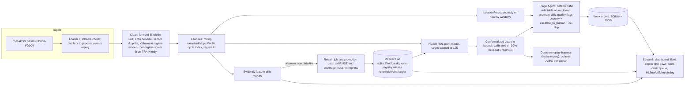

# Tata Elxsi TELIPORT Season 4 — Case-Study Selection Report

Prepared 2026-10-18. Companion files in this folder: `00_requirements_matrix.md` (Phase 0, PDF-faithful extraction), `01_scoring_model.md` (Phase 3 weights, fixed before any result was read), `evidence/` (the 24 agent outputs as JSON in `agent_outputs/`, the scoring scripts `final_matrix.py` and `parse_results.py` whose outputs `_matrix.json` and `_final.json` hold every number in Sections A–C, the local reproduction scripts and log, and `local_reproduction_notes.md` with the reviewers' verbatim measurements).

Labels used throughout: **[VF]** verified fact (fetched, downloaded or executed on 2026-10-18); **[SDR]** source-derived requirement (quoted from a case-study PDF); **[TI]** technical inference; **[UA]** unverified assumption; **[HYP]** hypothesis about competing teams (no data on actual TELIPORT entrants exists).

---

## 0. How this decision was produced (audit trail)

All five PDFs were located in the workspace, extracted with `pdftotext`, and every page was also rendered to an image and read to recover the tables whose columns the text extraction had misaligned (Case 1 Round 1 weights, Case 2 weights, Case 4 reference URLs). Cleaned transcriptions were produced and used as the single source for every agent.

A 24-agent workflow then ran with live web access (per the workflow run summary: 700 tool calls, 2.64 M tokens, no errors or empty results; these process metrics are not themselves in the result files):

| Stage | Agents | What they did | Independence |
|---|---|---|---|
| Specialists | 5 (one per case) | Investigated how to WIN each case; fetched datasets, model cards, repos, standards; ran local reproductions (C-MAPSS baseline on all four subsets; WSL2 `tc`/netem testbed; PyBaMM ECM; zxing-cpp GS1 decode; openFDA/EUR-Lex downloads). 12-point mandatory output plus 12 dimension scores and 3–5 critical claims each. | Saw only their own PDF and the team background |
| Blind judges | 2 (industry engineer; strict rubric evaluator) | Scored all five cases per official criterion and weight for THIS team | Ran in parallel with the specialists; never saw any specialist output |
| Adversarial reviewers | 3 (technical skeptic; competition strategist; red-team) | Attacked the leaders' evidence, re-ran the specialists' scripts, checked kernel configs, licences, papers; produced rankings and explicit score deltas | Saw all five specialist outputs |
| Fact-checkers | 12 (4 claims × 3 cases) | Tried to refute each critical claim from primary sources | One claim each |
| Competitor/novelty analysts | 2 (top-2 candidates) | Generic student build vs. a validated innovation; prior-art search | Saw specialist, fact-check and review notes for their case |

Which cases were fact-checked: the workflow picked the top three by its *preliminary* specialist-only composite (Case 1 8.08, Case 3 7.54, Case 4 7.36, Case 2 7.31, Case 5 7.29), so Cases 1, 3 and 4 received fact-checkers and **Cases 2 and 5 did not**. Case 5's critical claims (Pi tokens/s, VED contents, llama-server timings, ROAD replay, opendbc) were therefore not fact-checked at that stage; the red-team and strategist did independently verify the WSL2 kernel config (no vcan), the Raspberry Pi AI HAT documentation, the CARLA requirements and the dataset pages, and all Pi throughput figures remain community numbers **[UA]**. Case 2's PyBaMM run was independently re-executed by the strategist.

I (the orchestrator) additionally verified three facts directly: the data.nasa.gov C-MAPSS page and direct zip link exist **[VF]**; a 2020 Microsoft Q&A thread reporting that the stock WSL2 kernel of that time lacked the netem module **[VF]**; and community Raspberry Pi 5 throughput of roughly 11 tokens/s for a 1B-parameter Q4 model **[UA, community]**.

Fact-check outcomes: of 12 claims, **7 were confirmed** and **5 were partially confirmed with a precise correction**; **none was refuted**. All corrections are folded into the blueprint below.

Reproduction provenance for the Case 1 baseline (used throughout): the specialist's original run on all four subsets; one independent four-subset re-run by a fact-checker (its log is `evidence/cmapss_baseline_rerun.log`); and two further independent FD001-only re-runs by the skeptic and the strategist. All four runs agree to within 0.4 RMSE.

What could NOT be found: any official TELIPORT Season 4 page, rules, judge list, prior-winner list or scoring commentary. Everything about competition format is third-party and labelled **[UA]**. Two third-party listings put Round 1 submissions closing **24 Oct 2026** and Round 2 in the window **14 Nov–13 Dec 2026 [UA]**; Season 3 is described by a third-party blog as a one-slide Round 1 and a 10-slide (≤5 MB) Round 2 deck with prototypes only as annexures **[UA]**. If these are true, the deliverable is deck-first and the first deadline is six days from the date of this report. Confirm this on the official portal before planning.

---

## A. Executive decision

**Winning candidate: Case Study 1 — Self-Healing Machines: Predictive Maintenance for a Connected Fleet.**

| Measure | Value |
|---|---|
| Risk-adjusted score (0–10) | **7.86** (runner-up Case 3: 7.26; then 6.72 / 6.56 / 6.54) |
| Official-score potential | 7.90 (specialist 8.3; blind judges 7.6 and 7.8) |
| Execution-adjusted potential | 7.60 (skeptic-corrected specialist 7.3; blind judges 7.5 and 8.0) |
| Confidence | **High.** Case 1 ranked first under all four cross-case weighting schemes and under all four input views (rubric-only, blind-judges-only, raw specialist, risk-adjusted), with both blind judges and with all three adversarial reviewers. Its load-bearing facts were reproduced on this machine. |

**Three strongest reasons to choose it**

1. **It is the only case where every input and every mark is fixed and public.** The PDF mandates the dataset (NASA C-MAPSS, verified downloadable, 12.4 MB), names the deliverables for both rounds, and gives explicit weights for 14 criteria. In Round 2, "Working pipeline" (20%) + "Demo & explanation" (20%) = 40%, and "Data engineering quality" (15%) + "MLOps in action" (10%) + "Agent behavior" (10%) = a further 35%: engineering completeness, which is this team's strength. "Model performance" is only 15%. **[SDR]**
2. **Feasibility is proven, not estimated.** A no-tuning scikit-learn gradient-boosting baseline with rolling features was run on all four subsets on this Windows laptop, CPU-only, in 1.2–3.5 minutes each, and independently re-run (once on all four subsets, twice more on FD001) by other agents: FD001 test RMSE 14.2 against capped truth, NASA score ≈310. The whole free tool stack (MLflow, Evidently, River, Streamlit, scikit-learn) resolves in `pip` without conflicts. **[VF]**
3. **The crowd competes on the wrong 15%.** The GitHub `cmapss` topic lists 53 repos and `remaining-useful-life` 217; of the 20 `cmapss` repos that rendered, none mentions MLflow, drift, retraining or a triage agent (descriptions inspected, not code) **[VF]**. The modal student submission is hypothesised to be an FD001 LSTM notebook with a dashboard **[HYP]**. The closed loop the rubric actually scores (interval-driven triage, drift-gated retraining with a promotion gate, all four subsets, leakage-audited evaluation, and a decision-replay evaluation of the agent as a maintenance policy) was absent from every public repo and from the one self-reported hackathon-winner repo found (from a different competition) **[VF for the search; TI for the conclusion]**.

**The single biggest reason not to choose it**

It is the most crowded and most templated of the five problems, so the ceiling for "wow" is low and the field of competent entries will be the largest. The differentiators are integration-level and honesty-level engineering, which must be made visible in a deck-first format; a judge who wants a visibly new idea may score the ML as a competent reproduction. The GBM-plus-conformal-interval design itself is published (Robinson, IJPHM 2026) and must be cited, not claimed.

**Conditions under which the recommendation would change**

Scenario scores below were recomputed with `evidence/final_matrix.py` by changing the named dimensions from their adjusted values; everything else held constant.

- **A teammate has demonstrated Linux networking fluency** (tc/HTB/netem, namespaces, root). Setting Case 3 skill-fit 6→9, low-failure-risk 6.5→8 and demo-reliability 6.5→8 gives 8.23 vs Case 1's 8.13 on base weights. All three adversarial reviewers state Case 1 *loses* to Case 3 under this condition; the dimension model says the two are within 0.1. The official-score and execution inputs were estimated assuming no such teammate, so the risk-adjusted score (7.41 vs 7.86 with those inputs unchanged) understates Case 3 in this scenario. Honest conclusion: with such a teammate the choice is a genuine toss-up between a less crowded field with a prescribed evidence format (Case 3) and the lowest-variance path (Case 1); without one, Case 1.
- **Judges reward visible, dramatic, hard-to-fake measurements over rubric completeness**, or the finale allows live/video demos (skeptic, red-team): a 638 ms → 41 ms latency plot is more memorable than a 14.2 RMSE on a benchmark with 53 public repos. Favours Case 3 **[TI]**.
- **Judges read "Demo & explanation" as an innovation showcase** rather than articulation of trade-offs (red-team): Case 3's verify-or-rollback loop or Case 4's regulation-as-data registry reads as more inventive **[TI]**.
- **Judging is relative within each case** and Case 1 attracts the most ML-capable pool: the margin narrows **[UA]**.
- **A battery/thermal engineer joins** (Case 2 with skill-fit 6→9, engineering-depth 5.5→8, reproducible-evidence 6→8 reaches 7.67) or **a regulatory-affairs person joins** (Case 4 with skill-fit 7.5→9, measurable-results 7→8, low-failure-risk 6.5→8 reaches 7.59), or **the competition is strictly deck-only with code never examined** (red-team: favours Case 4). None reaches Case 1's 8.13.
- **The team already owns a Raspberry Pi 5 and a native Linux box** (Case 5 with demo-reliability 5→7, low-failure-risk 4→6.5, data-availability 6.5→7.5 reaches 7.55). Still behind.

---

## B. Ranked leaderboard (all scores 0–10, after adversarial adjustment)

| Rank | Case | Official-score potential | Execution-adjusted | Feasibility¹ | Differentiation | Data availability | Demo reliability | Risk-adjusted | Main failure risk | Confidence |
|---|---|---|---|---|---|---|---|---|---|---|
| 1 | **1 Predictive Maintenance** | 7.90 | 7.60 | 8.3 | 5.5 | 10.0 | 7.0 | **7.86** | Commoditisation: indistinguishable from the hypothesised FD001-notebook crowd **[HYP]** if the closed loop is not made visible | High |
| 2 | 3 Adaptive QoS Engine | 7.23 | 6.90 | 8.2 | 6.5 | 7.0 | 6.5 | **7.26** | Linux-networking skill gap; root/kernel-dependent, silently-failing `tc` configuration; no CAKE on stock WSL2 **[VF]** | Medium |
| 3 | 5 VehicleGPT | 6.77 | 6.37 | 6.7 | 6.0 | 6.5 | 5.0 | 6.72 | No ARM hardware → unverifiable Edge Performance; LLM path unlikely to meet 2 s on two A5x-class cores **[TI on community figures]**; vcan absent on stock WSL2 **[VF]** | Medium |
| 4 | 2 Battery Platform | 6.77 | 5.87 | 8.0 | 6.5 | 6.0 | 8.0 | 6.56 | Physics is fitted, not validated; 35% of weight is battery-engineering judgement under expert questioning | Medium |
| 5 | 4 Medical Labeling | 6.73 | 5.73 | 7.5 | 7.0 | 6.0 | 7.5 | 6.54 | No dataset, no weights, no mandated prototype → slideware can tie on 5 of 7 criteria **[TI]**; one wrong clause in front of regulatory-domain judges (judge composition inferred from Tata Elxsi's HLS service pages **[TI]**) | Medium-low |

¹ Feasibility = mean of complete-prototype, free-tools, and low-failure-risk dimensions.

Ranks 3–5 are within 0.2 points and reorder under different schemes (base weights: 4 > 2 > 5; blind judges: 5 > 2 > 4; all three reviewers put Case 5 last on hard environmental facts). They are effectively tied and none should be chosen; what would separate them is listed in Section H.

**Sensitivity (order and scores under each scheme; columns in case order 1–5)**

| Scheme | Order | cs1 | cs2 | cs3 | cs4 | cs5 |
|---|---|---|---|---|---|---|
| Base weights (ours) | 1, 3, 4, 2, 5 | 8.13 | 7.12 | 7.72 | 7.25 | 7.07 |
| Equal weights | 1, 3, 4, 5, 2 | 8.21 | 7.08 | 7.75 | 7.38 | 7.21 |
| Ambition-weighted | 1, 3, 4, 5, 2 | 7.76 | 6.88 | 7.70 | 7.14 | 7.08 |
| Safety-weighted | 1, 3, 2, 4, 5 | 8.32 | 7.41 | 7.71 | 7.19 | 6.71 |
| Rubric-only (official-score mean) | 1, 3, then 2 = 5 (tie), 4 | 7.90 | 6.77 | 7.23 | 6.73 | 6.77 |
| Blind-judges-only (execution) | 1, 3, 5, 2, 4 | 7.75 | 5.30 | 6.80 | 5.20 | 6.15 |
| Specialist raw (no adjustments) | 1, 3, 5, 4, 2 | 8.28 | 7.41 | 7.80 | 7.49 | 7.54 |
| Risk-adjusted final | 1, 3, 5, 2, 4 | 7.86 | 6.56 | 7.26 | 6.54 | 6.72 |

The first four rows are independent weightings of the same adjusted dimensions; the last four are different input views. The closest is "ambition-weighted" (differentiation 20%, engineering depth 15%): Case 1 leads Case 3 by 0.06 there. Under base weights Case 3 would need +0.41 on every dimension to tie.

**Score provenance.** Dimension scores came from the specialists (advocates for their own case, so biased upward). The three reviewers' explicit deltas were then applied (e.g., Case 1 differentiation −1.0 net; Case 5 low-failure-risk −2.0; Case 2 reproducible-evidence −1.0 because its charge-time validation step never executed; Case 4 rubric-alignment −1.0 because its concept omitted the PDF's "Label Design using AI" ask). Then three synthesizer deltas were applied with stated reasons: Case 1 differentiation +0.5 (the decision-replay harness is in no public repo found); Case 2 skill-fit −2.0 (both blind judges and the specialist's own counter-argument say the physics cannot be defended); Case 4 skill-fit −0.5 (two of seven criteria need regulatory-affairs judgement the team lacks). Official-score potential = mean of the specialist and the two blind judges. Execution-adjusted = mean of the skeptic-corrected specialist value and the two blind judges. Risk-adjusted = 0.35 × official + 0.35 × execution + 0.30 × base-weighted dimensions. Every value is reproducible from `evidence/final_matrix.py` and `evidence/agent_outputs/`.

---

## C. Official rubric breakdown

Realistic target per criterion = mean of the specialist and the two blind judges, rounded to one decimal. **Hard** = both blind judges flagged the criterion hard to earn; **Hard (1 judge)** = one of the two did (the specialists' outputs carry no such flag). Criterion names and weights are exactly as printed in each PDF **[SDR]**.

### Case 1 (chosen) — Round 1 weighted target ≈ 8.0 / 10, Round 2 ≈ 7.8 / 10

| Round | Criterion (weight) | Target | Feature / evidence that earns it | Hard? |
|---|---|---|---|---|
| 1 | Problem understanding (15%) | 8.3 | Closed-loop framing; explicit treatment of "mild imbalance" as a severity-class imbalance; human-for-exceptions rule; verified dataset facts (FD004 file/readme count mismatch) | |
| 1 | Architecture clarity (20%) | 8.2 | One diagram: data → clean → features → anomaly + RUL + interval → triage agent → work order, with MLflow registry, drift monitor and retrain loop as side-channels; a simple and a detailed version | |
| 1 | Data engineering approach (15%) | 7.8 | Train-only regime clustering (KMeans 6) and per-regime scaling for FD002/FD004; sensor drop list; quality flags; engine-level splits with random truncation | |
| 1 | ML approach & reasoning (20%) | 7.8 | GBM + conformal intervals + IsolationForest justified against the 15% accuracy weight, explainability, CPU retraining; cites Robinson 2026 as the baseline design; a deep challenger logged for comparison | Hard |
| 1 | MLOps & agent logic (15%) | 8.0 | Drift-triggered retraining with promotion gate; deterministic severity rule table with escalation and de-duplication | |
| 1 | Dataset coverage (10%) | 7.7 | All four subsets through configuration with regime and dual-fault handling, planned from Round 1 | Hard |
| 1 | Communication quality (5%) | 8.0 | PDF terminology reused; one diagram everywhere | |
| 2 | Working pipeline (20%) | 8.3 | `make demo` from a clean clone; pinned lock file; Docker; pytest; offline | |
| 2 | Data engineering quality (15%) | 7.8 | Reproducible seeds, schema checks, feature manifest, train-only fitted preprocessing | |
| 2 | Model performance (15%) | 7.2 | Verified baseline RMSE 14.2 / 16.2 / 14.1 / 17.9 (capped) and 15.4 / 27.9 / 15.7 / 28.9 (raw) with PHM08 score and convention printed; interval coverage per subset; honest literature band | Hard |
| 2 | MLOps in action (10%) | 7.8 | MLflow on SQLite backend with aliases; retrain job fired by Evidently feature-drift alarm; gate shown accepting AND rejecting | |
| 2 | Agent behavior (10%) | 8.3 | Unit-tested rule table on the interval lower bound; decision confusion matrix; work-order de-duplication; escalation measured | |
| 2 | Dataset coverage (10%) | 7.7 | Per-subset results table for FD001–FD004 (already produced in baseline form) | Hard |
| 2 | Demo & explanation (20%) | 7.7 | "Honest metrics" slide (2.5-vs-14.2 leakage trap; capped vs raw); trade-offs: GBM vs deep, point vs interval, cap vs uncapped | Hard (1 judge) |

Marks that will remain difficult: beating published deep models on RMSE (not required: "credible" is the word used); full marks on Dataset coverage (FD002/FD004 regimes genuinely harder); Demo & explanation if the format is deck-only and the closed loop is not made visual.

### Case 3 — unweighted mean target ≈ 7.2 (PDF gives no weights)

| Criterion | Target | Feature / evidence that would earn it | Hard? |
|---|---|---|---|
| Accuracy of classification and link estimation | 6.7 | Confusion matrix with confidence histogram on held-out self-generated captures; `/correct` endpoint; link-estimation error (%) and convergence time vs the netem ground-truth rate. Classification on self-generated traffic is near-tautological **[TI]** | Hard |
| Reduction in interactive latency, jitter and packet loss | 8.0 | Scripted baseline-vs-optimised runs (N ≥ 10) with bootstrap CIs; HTB + fq_codel measured once on this machine's WSL2 at 638 → 41 ms mean RTT under load **[VF]** | |
| Fairness and absence of starvation | 7.3 | HTB rate floors; Jain's index across the three TV streams; bulk floor never breached | |
| Adaptation speed and policy stability | 6.7 | Time-to-recover after the 100→20 Mbps step; rate flips per minute; verify-or-rollback ledger. WSL2 idle spikes of 40 ms can false-trigger a naive AIMD rule **[VF]** | Hard |
| CPU overhead, reproducibility and clarity of results | 7.5 | Controller CPU% and RSS; one-command seeded suite; CI re-run; report generator | |

### Case 2 — weighted target ≈ 6.8

| Criterion (weight) | Target | Feature / evidence that would earn it | Hard? |
|---|---|---|---|
| Problem understanding (15%) | 7.0 | Defined application (e.g., 48 V 13s3p module), requirements, operating conditions from datasheets | Hard (1 judge) |
| Desirability (15%) | 7.0 | Student/engineer trade-off explorer user story | |
| Technical feasibility (20%) | 7.5 | Free tools verified (PyBaMM Thevenin solves in 0.12–0.24 s on Windows **[VF]**); sub-second simulations; bounded scope | Hard (1 judge) |
| Engineering quality (15%) | 6.0 | ECM + lumped thermal with stated assumptions and sensitivity bands; the lumped assumption fails under forced air (Biot ≈ 0.6 at h = 28 W/m²K) **[VF calculation]** | Hard |
| Prototype & evidence (15%) | 6.8 | Two alternatives vs baseline on usable energy, peak temperature, charge time, mass, cost; the only free thermal-validation table is a proprietary-marked reseller-hosted datasheet now returning HTTP 520 **[VF]**; the smoke test's charge steps never executed **[VF]** | Hard |
| Innovation (10%) | 6.5 | Provenance-tagged constraint/interface-conflict engine; live traceability matrix | |
| Business viability (10%) | 6.3 | Training-tool / pre-design screening story; unbacked cost claims | |

### Case 4 — unweighted mean target ≈ 6.7 (PDF gives no weights)

| Criterion | Target | Feature / evidence that would earn it | Hard? |
|---|---|---|---|
| Understanding of labeling problem | 6.8 | Process map of the PDF's 18-step traditional approach with pain points; FMEA/RCA; Automation Opportunity Matrix | |
| Regulatory/compliance awareness | 5.8 | Requirement registry citing MDR Annex I 23.2 (a)–(s)/23.3, 21 CFR 801.15/801.18/801.20, GS1, EC language table (all free, verified **[VF]**); ISO 15223-1/20417 are paid | Hard |
| Innovation ideas considering Label Design using AI | 6.8 | Citation-guarded LLM; an AI-assisted label-assembly module must be added (the recommended concept omitted it) | |
| AI/automation platform | 7.2 | FastAPI/React platform: rules engine, CV redline, barcode re-decode (zxing-cpp GS1 decode verified on Windows **[VF]**), workflow, connectors abstraction | |
| End-to-end process coverage | 6.0 | A working slice (change impact → content → check → redline → approval → release); the rest simulated | Hard |
| Accuracy & validation approach | 6.8 | Seeded-error benchmark on labels generated from real openFDA GUDID records (keyless, CC0 **[VF]**); per-class precision/recall; LLM-only baseline with fabrication rate | Hard (1 judge) |
| Traceability & auditability | 7.7 | Element → product field → rule → clause URL → evidence box → approver → change order; hash-chained audit log | |

### Case 5 — unweighted mean target ≈ 6.7 (PDF gives no weights)

| Criterion | Target | Feature / evidence that would earn it | Hard? |
|---|---|---|---|
| System Architecture | 7.3 | Gateway → ingest → tiered store → query planner → deterministic analytics → UI, with safety-domain isolation | |
| AI Capability | 6.7 | 0.5B model as NL → QueryPlan compiler with JSON-schema output; accuracy on a 200–300 query benchmark; community test shows a 0.5B model followed instructions in 11/18 replies **[UA]** | Hard |
| Data Integration | 5.7 | Real SocketCAN + DBC path and UDS/DTC path; SOME/IP, VHAL, QNX, camera only as documented stubs; vcan not built into stock WSL2 **[VF]** | Hard |
| Search & Analytics | 7.3 | Tiered store (1 Hz 48 h; 1-min aggregates 8+ weeks); change-point, z-score, pre-event timelines; scenario engine with ground truth | |
| Edge Performance | 6.0 | Measured RSS and p50/p95 latency under a 2-core/2 GB cgroup on real ARM; the LLM tier is unlikely to meet 2 s on two A5x-class cores (0.5B ≈ 8 tok/s on a four-core Pi 4 **[UA]**) **[TI]**; AI HAT+ (Hailo-8/8L) does not support LLMs, only AI HAT+ 2 does **[VF]** | Hard |
| Privacy & Security | 7.0 | Local-only proof (egress blocked), read-only adapters, PII-free schema | |
| Innovation & Practicality | 6.7 | Single-container deployment; VSS-based schema; value for validation teams | |

---

## D. Winner's solution blueprint — Case 1

### 1. Concept and name
**SentinelLoop: a decision-audited, drift-gated prognostics loop for a connected fleet.** One reproducible Python repository that runs all four C-MAPSS subsets through configuration, predicts RUL with calibrated uncertainty, lets a deterministic Triage Agent act on the *lower bound* of that uncertainty, retrains only when drift is detected and only if a promotion gate passes, and evaluates the agent as a *maintenance policy* by replaying every official test engine cycle-by-cycle with zero label leakage.

### 2. Problem and target user
Fleet maintenance operations (planners and technicians) who need work orders raised before failure with minimal false alarms, plus the ML/MLOps engineer who keeps the model alive. The PDF's own words: detect early degradation, predict RUL, auto-raise a work order, human only for exceptions **[SDR]**.

### 3. Architecture

### 4. Component-by-component stack (with reasons)

| Component | Choice | Why |
|---|---|---|
| Language / runtime | Python 3.11+ | River 0.26 requires ≥3.11; Evidently ≥3.10; keeps all three coexisting **[VF]** |
| Data | pandas 2.x pinned, NumPy | 45 MB of text, 160k rows: PySpark is scope inflation. Pin pandas 2.x: an unpinned install resolves pandas 3.0 whose copy-on-write defaults were not exercised in the reproduction **[VF]** |
| RUL model | scikit-learn `HistGradientBoostingRegressor` | CPU-trainable in minutes, explainable, retrains live in a demo; verified RMSE within the published classical band **[VF]**. LightGBM crashed with an access violation on this Windows machine: do not depend on it **[VF]** |
| Uncertainty | Conformalized quantile regression (quantile GBM bounds + split-conformal calibration on 30% of training engines) | Robinson (IJPHM 2026) reports 88–92% coverage at 90% nominal with this recipe in a single fixed-seed run; Javanmardi & Hüllermeier (IJPHM 2023, public code) report roughly 0.84–0.95 over 15 splits **[VF]**. Expect subset-dependent coverage in that range **[TI]** |
| Anomaly | scikit-learn `IsolationForest` on healthy-phase windows + GBM health index | Satisfies "detect abnormal behaviour" and the "mild imbalance" ground rule explicitly; explainable |
| Evaluation | GroupKFold by engine with random truncation; official test files | Mimics the official protocol; prevents the leakage trap (last-cycle CV on training engines gives RMSE 2.5–2.7 vs 14.2 on the real test; observed in all four runs) **[VF]** |
| Experiment tracking | MLflow 3.x with `sqlite:///mlflow.db` backend and **aliases**, not stages | The Model Registry does not work on the default `mlruns` file store; stages are deprecated since 2.9 **[VF, correction from fact-check]** |
| Drift | Evidently 0.7.23 DataDriftPreset (feature drift) pinned; River ADWIN only on completed engines | Residual drift cannot be computed live (true RUL unknown until failure): the live story is feature drift plus a same-subset false-alarm test **[VF correction]** |
| Agent | Plain Python module, pure functions, pytest | PDF: "no LLM", "simple rules or thresholds" **[SDR]** |
| Storage | SQLite | Zero infrastructure; one file; judges can open it |
| Dashboard | Streamlit, pinned with a compatible plotly | `import streamlit` failed on this machine from a plotly mismatch: pin and test from a clean clone **[VF]** |
| Packaging | `requirements.txt` + lock file, Dockerfile, Makefile with `make doctor` (checks Python version, imports, dataset ETag), `make demo`, `make replay`, `make test` | "Runs end-to-end with minimal manual intervention" is worth 20% |
| Stream mode | In-process generator replaying test engines cycle by cycle | Shows the closed loop live without a broker; Kafka adds fragility and no marks |

### 5. Dataset sources and collection strategy
- Primary: NASA PCoE S3 archive, 12,429,152 bytes, ETag `a83e8f128c59fc5614a4ca2e42a2e30c`, no login; inner `CMAPSSData.zip` with 14 files. Download script verifies the ETag and keeps a local copy **[VF]**.
- The PDF's official page `data.nasa.gov/dataset/cmapss-jet-engine-simulated-data` is live but intermittently unreachable (one connection failure in three attempts); it states "License not specified" and asks for the Saxena et al. PHM08 citation **[VF]**.
- Verified counts (cite file-derived, not readme): FD001 100/100 units; FD002 260/259; FD003 100/100; FD004 **249 train / 248 test** (the readme says the reverse) **[VF]**.
- Backup mirror: Hugging Face `THULab/nasa_cmapss_rul` (CC0 per card) **[VF]**.
- No synthetic data needed. Streaming is simulated by replay and labelled as such.

### 6. Core algorithm / engineering method
1. Clean and regime-normalise (train-only fit). 2. Rolling features. 3. IsolationForest anomaly score; HGBR point RUL on cap-125 target; CQR bounds calibrated on held-out engines. 4. Triage rule table (thresholds tuned on validation engines only): CRITICAL if `rul_lower ≤ 10` or (anomaly high and `rul_point ≤ 25`); HIGH if `rul_lower ≤ 25`; MEDIUM if `rul_lower ≤ 50`; WATCH if anomaly elevated; ESCALATE_TO_HUMAN if interval width > threshold, drift active, data-quality flags, or conflicting evidence; one open order per engine. 5. Feature-drift alarm → retrain → gate (validation RMSE ≤ champion and coverage ≥ 0.85) → alias promotion or logged rejection.

### 7. The novel element
**A leakage-free decision-replay harness that scores the Triage Agent as a maintenance policy.** Because official test trajectories are truncated with a known final RUL, the true RUL at every replayed cycle is `RUL_final + (T_last − t)`, so the cycle at which the agent first raises HIGH/CRITICAL can be compared with the true failure cycle with no synthetic labels. Three policies are compared on identical predictions, per subset: (A) point-RUL threshold (the generic agent), (B) fixed fleet-wide safety margin, (C) interval-lower-bound threshold (grounded in Mitici et al., RESS 2023, where the optimal replacement time sits near the lower bound of the 99% RUL confidence interval; our intervals are 90%, so the threshold is re-tuned on validation engines). Output: late-order rate, mean discarded life at first order, mean lead time, order churn, escalation share. No public C-MAPSS repo inspected (20 of 53 rendered; descriptions, not code) and no hackathon repo found reports any of these; they stop at RMSE **[VF for the search; TI for the conclusion]**. The ML underneath is published (Robinson 2026) and must be cited as such.

### 8. Baseline-versus-improved validation plan

| Subset | Naive mean-RUL | RandomForest | HGBR baseline (capped / raw) | NASA score (range) | Improved target |
|---|---|---|---|---|---|
| FD001 | 41.9 | 14.4 | **14.2 / 15.4** | ≈310 (300–320) | ≤ 13.5 capped; PICP ≥ 0.88 |
| FD002 | 44.9 | 16.9 | **16.2 / 27.9** | ≈1230 | ≤ 15.5; PICP ≥ 0.85 |
| FD003 | 43.7 | 15.3 | **14.1 / 15.7** | ≈460 (380–460) | ≤ 13.5; PICP ≥ 0.84 |
| FD004 | 45.6 | 18.2 | **17.9 / 28.9** | ≈1920 (1800–1950) | ≤ 17.0; PICP ≥ 0.85 |

Baseline numbers are from the independent four-subset re-run of `evidence/cmapss_baseline.py` (log: `evidence/cmapss_baseline_rerun.log`); the specialist's original four-subset run and two further FD001-only re-runs agree within 0.4 RMSE **[VF]**. NASA scores vary ±20% across machines and library versions: quote ranges, fix seeds and thread counts. Decision-level acceptance claim: policy C has a lower late-order rate than A at comparable or modestly higher discarded life, and escalations concentrate on the engines where the point model is worst. If the data do not show that, report it anyway; the harness is the deliverable.

### 9. Exact metrics and how to compute them
- RMSE = sqrt(mean((rul_pred − rul_true)²)) over the LAST cycle of each official test engine; report against cap-125 truth AND raw truth.
- PHM08 score = Σ over engines of exp(−d/13) − 1 for d < 0 and exp(d/10) − 1 for d ≥ 0, d = predicted − true (late penalised more). The original Saxena 2008 text lists a1 = 10, a2 = 13 with ambiguous branch assignment, so print the convention on the slide and unit-test the function **[VF]**.
- PICP = fraction of test engines whose true RUL lies inside [lower, upper] at 90% nominal; MPIW = mean interval width.
- Anomaly: detection delay in cycles and false-positive rate on the healthy phase, per subset.
- Agent: precision/recall of HIGH/CRITICAL against true RUL ≤ 25; false-alarm rate on engines with true RUL > 60; escalation share; late-order rate; discarded life; lead time; churn.
- Drift: detection on a regime-shift replay plus false-alarm count on same-subset healthy windows (the FD001→FD002 shift alone drifts by construction and is a strawman).
- Retraining: validation RMSE before/after and the gate's accept/reject decision with reason.
- Run time: wall-clock per subset from `make demo`.

### 10. Expected demo sequence (deck-first, live if the finale allows)
1. `make demo SUBSET=FD001` from a clean clone: metrics table and MLflow run id on screen.
2. Dashboard: fleet heatmap → engine with low RUL → interval band and anomaly score.
3. Stream replay of five test engines: RUL falls, interval narrows, agent raises HIGH then CRITICAL with evidence JSON; one ESCALATE_TO_HUMAN case where the interval is too wide.
4. Drift scenario: feature-drift alarm → retrain in under two minutes → gate accepts; a second run where the gate rejects a worse challenger.
5. `make replay`: the policy table A/B/C per subset.
6. `--all`: per-subset results for FD001–FD004.
7. "Honest metrics" slide: capped vs raw RMSE; the 2.5-vs-14.2 leakage trap; literature band 11–21.
8. `make test` output. Fallbacks: pre-populated MLflow/SQLite stores, recorded run, everything offline.

### 11. Failure handling and limitations
- Dependency breakage (observed on this machine): pinned lock file, Docker, rehearsal from a clean clone, pre-populated stores.
- Registry misconfiguration: SQLite backend, aliases, `mlflow ui --backend-store-uri sqlite:///mlflow.db`.
- Data site unreachable: S3 link with ETag check, local copy, HF mirror.
- Interval too wide early in life: treated as "insufficient evidence" (WATCH), not "healthy".
- Known limits to state openly: C-MAPSS is simulated with one snapshot per cycle; no real CMMS integration (work orders are JSON/SQLite records with a documented contract); residual drift is retrospective only; coverage is subset-dependent and the headline literature figure is a single run; cap-125 is a convention.

### 12. Requirement → implementation → proof

| Requirement (PDF) | Implementation | Proof artefact |
|---|---|---|
| Read sensor data batch or streaming; handle missing values and noise; rolling features | `ingest/`, `clean/`, `features/` with injected-missing handling and EMA | pytest; feature manifest in MLflow |
| Detect abnormal behaviour | IsolationForest + health index | Detection delay / FPR table per subset |
| Predict RUL | HGBR + CQR bounds | RMSE (capped, raw), PHM08, PICP/MPIW per subset |
| Track experiments and versions; retraining flow; monitoring view | MLflow SQLite registry; Evidently; retrain job + gate; dashboard tabs | Run ids, alias history, gate log with accept and reject cases |
| Rule-based Triage Agent, severity, auto work order, human for exceptions | `agent/triage.py` rule table; SQLite work orders; escalation flag | Unit tests; decision confusion matrix; replay policy table |
| Handle mild imbalance | Severity classes with reported distribution; thresholds tuned on validation engines; per-class recall | Confusion matrix slide |
| End-to-end without manual steps | `make demo`, Dockerfile | Clean-clone run recording |
| No LLM; open-source tools; documented design | Stack above; README with diagram | THIRD_PARTY_LICENSES.md |
| Dataset coverage FD001–FD004 | Config-driven subsets; regime clustering | Four-subset results table |
| Round 1 deck items | Architecture diagram; cleaning/feature approach; model choice with reasoning; agent logic | Deck |

---

## E. Minimum winning prototype

**Must-have (without these the submission is generic):**
- One-command pipeline on FD001 with pinned environment, Docker, `make doctor`, tests.
- HGBR RUL + official-protocol evaluation (capped and raw RMSE, PHM08 with printed convention).
- IsolationForest anomaly layer with delay/FPR numbers.
- Triage Agent as a unit-tested rule table producing SQLite/JSON work orders with escalation and de-duplication.
- MLflow on SQLite with aliases; one retrain run with a logged gate decision.
- Streamlit dashboard with four tabs (fleet, engine, work orders, MLflow/drift/retrain).
- Config for FD002–FD004 with train-only regime normalisation and a per-subset results table.
- Round 1 deck that reuses the one architecture diagram and the agent decision table.

**Differentiating (build in this order once must-haves are green):**
1. CQR intervals with measured PICP/MPIW per subset; agent acts on the lower bound.
2. Decision-replay harness (`make replay`) with the A/B/C policy table.
3. Feature-drift-triggered retraining demonstrated with both an accept and a reject, plus a false-alarm measurement on healthy windows.
4. "Honest metrics" slide with the reproduced leakage trap.

**Optional extensions (only if everything above is green):**
- Cost-calibrated threshold selection with a sensitivity sweep over the failure-vs-early-replacement cost ratio, tied to the PHM08 asymmetry.
- A logged 1D-CNN/LSTM challenger (MLflow comparison only).
- Per-engine decision traces attached to MLflow runs.

**Explicitly avoid (risk without marks):**
- Any LLM or agent framework in the triage layer (non-compliant with the ground rules).
- Kafka/Redpanda, Airflow, multi-service Compose, PySpark.
- Chasing transformer RMSE; window-level splits; scalers fit on train+test.
- MLflow stage transitions or the file-store registry.
- "Residual drift" computed live; FD001→FD002 as the sole drift demo.
- Quoting the arXiv 2607.16493 "99.9% vs 20–60%" line as an RUL effect (it is a classification figure and the "20–60%" is not in the paper), quoting Mitici's 53% cost saving as our expected gain, or presenting 88–92% coverage as guaranteed.
- Copying GPL-3.0 notebook code or the unlicensed conformal-RUL repo.
- Six-tab dashboards, auth, chat bots, calendars.
- Artefacts over a 5 MB deck limit (if the Season 3 precedent holds **[UA]**).

---

## F. Execution roadmap (relative time; convert once the facts below are known)

| Stage | Relative effort (person-days, 3–4 people in parallel tracks) | Exit criterion |
|---|---|---|
| 0. Feasibility validation | 0.5 (largely done: dataset on disk, baseline reproduced, stack resolves) | `make doctor` passes on every teammate's machine from a clean clone |
| 1. Data and environment | 1.0 | Loader, cleaner, features for FD001 with tests; lock file; Docker |
| 2. Core implementation | 3.0 | HGBR + official evaluation + MLflow (SQLite); CQR; IsolationForest; agent + work orders + tests |
| 3. Integration | 2.5 | Dashboard; stream replay; config for FD002–FD004; four-subset table |
| 4. Baseline comparison | 1.5 | Decision-replay harness; A/B/C table; drift + retrain + gate with accept and reject |
| 5. Testing and error handling | 1.0 | pytest green; clean-clone rehearsal; fallback stores; recorded run |
| 6. Presentation and rehearsal | 1.5 | Round 1 deck (first), then the Round 2 deck carrying every number (10 slides, ≤5 MB if the Season 3 precedent holds **[UA]**); two timed rehearsals |

Total ≈ 11–12 person-days of focused work **[TI]**; the technical skeptic argues 14–18 is more defensible for students learning MLflow 3 and Evidently 0.7 APIs. Plan for the upper figure.

**Information needed to turn this into a calendar:** (1) the official Round 1 and Round 2 deadlines (third-party listings say 24 Oct 2026 and 14 Nov–13 Dec 2026 **[UA]**: verify today); (2) team size and hours per week; (3) whether judges run code, watch a recording, or read a deck only; (4) deck/annex limits; (5) whether the finale is live. Given the possible six-day Round 1 window, build the Round 1 deck first from the architecture and agent decision table in this report, and start Stage 1 in parallel.

---

## G. Judge attack simulation (Case 1)

| # | Hardest question | What is being tested | Evidence needed | Honest answer strategy | Unfixable weakness |
|---|---|---|---|---|---|
| 1 | "C-MAPSS has 53 public repos. What is new here?" | Differentiation | Policy-replay table; registry/drift gate log; four-subset table | Cite Robinson 2026 for the ML; say our contribution is operational: evaluating the agent as a policy, drift-gated promotion, leakage audit, all four subsets | The ML itself is not novel |
| 2 | "Your RMSE 14.2 is against RUL capped at 125. What is it uncapped?" | Metric honesty | Dual table: 15.4 / 27.9 / 15.7 / 28.9 raw | Show both; explain why the cap is the published convention and why the agent uses the lower bound rather than the point | FD002/FD004 raw RMSE stays ≈28 |
| 3 | "How did you split? Show me you did not leak." | Data engineering | GroupKFold by engine; train-only scaler/KMeans; the 2.5-vs-14.2 trap reproduced | Walk through the protocol; show the trap slide | None |
| 4 | "Why not an LSTM or transformer?" | ML reasoning | Logged challenger run in MLflow; 15% weight; retrain time | Explainability, CPU retraining in seconds live, published gain is 1–2 RMSE points | A tuned deep model may post a lower number |
| 5 | "Your retraining is a button. Prove it is operational." | MLOps in action | Drift alarm → job → gate accept AND reject; alias history; false-alarm count on healthy windows | Demonstrate both outcomes; admit residual drift is retrospective only | Live residual drift impossible without labels |
| 6 | "How do you know 90% intervals really cover 90%?" | Uncertainty claims | PICP/MPIW per subset on held-out engines; literature range 0.84–0.95 | Report measured coverage; expect FD003-style under-coverage; say so first | Single-run variance; coverage is subset-dependent |
| 7 | "Does the agent actually prevent failures or just print JSON?" | Agent behaviour | Late-order rate, discarded life, lead time, churn, escalation share per policy | Show policy C vs A; explain the escalation rule and its measured rate | Simulated fleet; no real CMMS feedback |
| 8 | "Where is the 'mild imbalance' handled?" | Ground-rule compliance | Severity class distribution; class-weighted thresholds tuned on validation engines; per-class recall | Treat it as the severity-classification side of a regression task; show the confusion matrix | None |
| 9 | "Will this run on my laptop right now?" | Working pipeline | Clean-clone `make demo` recording; lock file; Docker; ETag-checked download | Offer the Docker path; show the recording if the live run cannot be attempted | Dependency drift after submission |
| 10 | "How would this work with real truck telemetry at 1 kHz?" | Practicality | Ingestion contract of the stream replay; known-limitations slide | State C-MAPSS is one snapshot per cycle; describe windowing/aggregation and what would change; do not claim production readiness | No real-fleet validation |

---

## H. Rejection analysis

**Case 3 — Adaptive QoS Engine (runner-up, 7.26).** Why it lost: joint-lowest adjusted skill fit (6.0, the lowest in the raw specialist scores) because of Linux traffic control, namespaces, root and silently failing `tc` semantics; unweighted criteria with one structurally weak criterion (classification accuracy on self-generated traffic is near-tautological **[TI]**); no CAKE in the stock WSL2 kernel **[VF]**, so the production-realistic reference needs a VM or CI; WSL2 idle timing spikes of 40 ms **[VF]** threaten the stability criterion; judges from a broadband practice would likely know OpenWrt SQM and cake-autorate **[TI]**. Strongest argument for it: all five criteria are measurable with order-of-magnitude effects, the testbed already works on this very machine (mean RTT under load 638 → 41 ms, measured once by the skeptic **[VF]**), the evidence format is prescribed by the PDF, and a "hypothesis-verify-rollback" actuator with ground-truth-scored capacity estimation maps one-to-one onto four PDF constraints and exists in no autorate project found **[VF for the search]**. It becomes the better choice if a teammate has real Linux-networking experience and the team has two uninterrupted weeks (all three reviewers' stated flip condition).

**Case 5 — VehicleGPT (6.72).** Why it lost: the only hard number (Edge Performance) needs ARM hardware the team is not known to have; on community figures a 0.5B model runs ≈8 tokens/s on a four-core Pi 4 **[UA]**, so the LLM path is unlikely to meet 2 s on two A5x-class cores **[TI]** and the honest architecture is "bypass the LLM for common queries", which flashier competitors could paper over **[HYP]**; `CONFIG_CAN_VCAN` is not set in the stock WSL2 kernel **[VF]**, so SocketCAN demos need a Linux VM; SOME/IP, VHAL and QNX can only be stubbed; two of five acceptance queries require synthetic fault data; ready-made packages (virtual CAN + DBC + MCP tools; a local-Ollama OBD assistant) erase the "real CAN" and "runs locally" differentiators **[VF]**; the most LLM-trendy case, so probably the largest and most jaded judge exposure **[TI]**; its critical claims were not fact-checked (see Section 0). Strongest argument for it: the team's model-integration skills fit, and the "LLM compiles, engine answers" design with evidence-cited answers and a cgroup-capped scaling table is a sound, defensible architecture. It becomes competitive only if the team owns a Raspberry Pi 5 (ideally AI HAT+ 2) plus a native Linux box and judges weight measured edge numbers over protocol breadth.

**Case 2 — Battery Design Platform (6.56).** Why it lost: 35% of the weight (Technical feasibility 20% + Engineering quality 15%) plus Prototype & evidence (15%) rest on battery physics the team cannot validate without a lab; the lumped-thermal assumption fails under the forced-air alternative (Biot ≈ 0.6 at h = 28 W/m²K) **[VF calculation]**; the single free thermal-validation table is a proprietary-marked reseller-hosted datasheet that now returns HTTP 520 **[VF]**; the PyBaMM smoke test only executed the discharge step, so the charge-time validation path is unproven **[VF]**; 25% of the weight is desirability and business pitch. Strongest argument for it: a weighted rubric with a built-in "compare at least two design options against a basic starting design" mandate, sub-second deterministic demos, and no open-source browser-based cell-to-module configurator with coupled thermal simulation was found **[VF for the search]**. It becomes the better choice if a teammate has battery/thermal engineering background and can own the physics under questioning.

**Case 4 — Medical Labeling Automation (6.54).** Why it lost: no dataset, no weights, no mandated prototype and an 18-step regulated process, so slideware with regulatory vocabulary could tie on five of seven criteria **[TI]**; Tata Elxsi's HLS pages advertise a labeling-automation service and a regulatory-intelligence platform **[VF]**, so judges are likely labeling/regulatory practitioners **[TI]** for whom one wrong clause is highly visible; ISO 15223-1 and ISO 20417 are paid; a free-tier hosted LLM is contractually unsuitable for label content **[VF]**; the widest spread of opinion among evaluators (specialist 6.8 vs judge 4.8 on execution). Strongest argument for it: largest absolute differentiation (no open-source medical-device label compliance checker was found **[VF for the search]**); every data source needed is free and verified (openFDA GUDID under CC0, EUR-Lex MDR consolidated text, public PMA IFUs, 21 CFR 801, GS1 specifications, EC language table) **[VF]**; a "regulation as data" registry with a citation-guarded LLM and a seeded-error benchmark would be unique. It becomes the better choice if a teammate has regulatory-affairs or QA experience, or if the competition turns out to be strictly deck-only with code never examined.

---

## I. Research appendix (evidence table)

| Claim | Source URL | Type | Establishes | Limitations |
|---|---|---|---|---|
| C-MAPSS archive downloads without login, 12,429,152 bytes, ETag a83e8f12…; inner zip has 14 files | https://phm-datasets.s3.amazonaws.com/NASA/6.+Turbofan+Engine+Degradation+Simulation+Data+Set.zip | dataset (NASA-hosted S3) | Data availability for Case 1 **[VF]** | Outside nasa.gov domain |
| Official PDF link is live; "License not specified"; cites Saxena PHM08 | https://data.nasa.gov/dataset/cmapss-jet-engine-simulated-data | official page | Terms; intermittent reachability **[VF]** | One of three fetches failed |
| PCoE repository entry 6 with S3 link; acknowledgement requested | https://www.nasa.gov/intelligent-systems-division/discovery-and-systems-health/pcoe/pcoe-data-set-repository/ | official page | Provenance **[VF]** | — |
| FD004 files: 249 train / 248 test units; readme says reverse | local inspection of the archive | dataset | Citable detail **[VF]** | — |
| HGBR baseline RMSE 14.2/16.2/14.1/17.9 capped, 15.4/27.9/15.7/28.9 raw; NASA ≈310/1230/460/1920; 1.2–3.5 min/subset | `evidence/cmapss_baseline.py`, `evidence/cmapss_baseline_rerun.log` | local run: one independent four-subset re-run; specialist original and two FD001 re-runs agree within 0.4 | Feasibility and baseline column **[VF]** | ±0.5 RMSE, ±20% score across machines |
| Naive last-cycle validation on training engines gives RMSE ≈2.5–2.7 (FD001) vs 14.2 on the real test | `evidence/cmapss_baseline_rerun.log` (2.71) and the three other runs (2.48) | local run | The leakage-trap slide **[VF]** | — |
| Saxena et al. 2008 define the asymmetric score with a1=10, a2=13 | https://c3.ndc.nasa.gov/dashlink/static/media/publication/2008_IEEEPHM_CMAPPSDamagePropagation.pdf | paper | Score definition **[VF]** | Branch assignment ambiguous in extracted text |
| De-facto convention exp(−d/13)−1 early, exp(d/10)−1 late | https://arxiv.org/pdf/2104.05049 | paper | How to compute honestly **[VF]** | — |
| Published FD001 RMSE band: SVR ≈21, CNN 18.5, LSTM 16.1, DCNN 12.6, transformer ≈11.4 | https://arxiv.org/pdf/2010.03207 | survey | Honest literature band **[VF]** | Secondary tables, differing protocols |
| GBM + asymmetric CQR on all four subsets: RMSE 13.26–16.85, coverage 88–92% at 90% nominal (single fixed-seed run) | https://www.papers.phmsociety.org/index.php/ijphm/article/view/4724 | paper (IJPHM 2026) | The ML design is published; coverage expectation **[VF]** | Single run; FD003 PICP 0.88 |
| Split-conformal/CQR over GB on C-MAPSS valid; coverage ≈0.84–0.95 over 15 splits; public code | https://arxiv.org/abs/2212.14612 ; https://github.com/alireza-javanmardi/conformal-RUL-intervals | paper + repo | Validity and variance **[VF]** | Repo has no licence; calibration split method unstated |
| Interval lower bound (99% CI) as replacement trigger; cost model | https://research.tudelft.nl/en/publications/dynamic-predictive-maintenance-for-multiple-components-using-data/ | paper (RESS 2023) | Grounding for policy C **[VF]** | Its 53% saving is not transferable |
| Chunk-based leakage-audited splits; naive splits inflate classification accuracy to 99.9% | https://arxiv.org/abs/2607.16493 | preprint (Jul 2026) | Leakage is a documented failure mode **[VF]** | Classification figure; do not quote "20–60%" |
| GitHub topic `cmapss` = 53 repos; `remaining-useful-life` = 217; none of the 20 rendered mention MLflow/drift/retraining/agent | https://github.com/topics/cmapss ; https://github.com/topics/remaining-useful-life | repo index | Crowding and the gap **[VF]** | Only first 20 rendered; descriptions inspected, not code; untagged repos unseen |
| A self-reported hackathon-winner C-MAPSS repo (different competition) reports only R² | https://github.com/adityapotdar23/Predictive-Maintenance | repo | Generic-build hypothesis **[VF for repo; HYP for TELIPORT]** | Prize self-reported; not TELIPORT |
| MLflow 3.17.1 Apache-2.0; Model Registry requires a database-backed store; stages deprecated since 2.9 | https://mlflow.org/docs/latest/ml/tracking/ ; https://github.com/mlflow/mlflow/issues/10336 | official docs | Registry configuration **[VF]** | — |
| Evidently 0.7.23 Apache-2.0, Python ≥3.10 | https://pypi.org/project/evidently/ | official | Drift tool availability **[VF]** | API churn; pin |
| River 0.26.1 BSD-3, Python ≥3.11, ADWIN | https://riverml.xyz/latest/api/drift/ADWIN/ | official | Optional drift tool **[VF]** | Scalar streams; no delayed labels |
| Full stack resolves in pip without conflict (142 packages) but pulls pandas 3.0 | pip dry-run on this machine | local | Environment feasibility **[VF]** | pandas 3 unexercised; pin 2.x |
| LightGBM access violation; Streamlit import failure (plotly); joblib traceback on Windows | local runs | local | Environment fragility **[VF]** | Machine-specific |
| Stock WSL2 kernel 6.6.87.2 (and 6.18.y) ships sch_htb/netem/fq_codel/ifb/flower as modules; sch_cake, sch_pie, vcan not built | https://raw.githubusercontent.com/microsoft/WSL2-Linux-Kernel/linux-msft-wsl-6.6.y/arch/x86/configs/config-wsl | official kernel config | Case 3 and 5 environment limits **[VF]** | Legacy 5.15 WSL kernels lack HTB/netem too |
| 2020 report that the stock WSL2 kernel of that time lacked sch_netem | https://learn.microsoft.com/en-us/answers/questions/48142/wsl2-qdisc-netem-support | community Q&A | Historical environment risk **[VF for the thread]** | Superseded by the 6.6.y config above |
| HTB + fq_codel reduces loaded mean RTT 638 → 41 ms on this machine's WSL2 (3-namespace testbed) | `evidence/wsl2_tc_testbed_check.sh`; measurements in `evidence/local_reproduction_notes.md` | local run (measured once by the skeptic) | Case 3 effect size **[VF]** | VM timing noise (40 ms idle spikes); single run |
| GitHub ubuntu-latest runners: passwordless sudo (official docs); linux-modules-6.17.0-1022-azure ships sch_cake/netem/htb/fq_codel | https://docs.github.com/en/actions/reference/runners/github-hosted-runners ; https://packages.ubuntu.com/noble-updates/amd64/linux-modules-6.17.0-1022-azure/filelist | official | Case 3 CI path **[partially confirmed; TI]** | No CI run was executed; kernel rotates per image; red-team flags as unverified |
| ISCXVPN2016 via no-password CIC form; CIC policy permits redistribution with citation | https://www.unb.ca/cic/datasets/vpn.html ; https://www.unb.ca/cic/datasets/index.html | official | Optional Case 3 data **[VF]** | Form returned a server error at check time |
| NFStream 6.6.0 cp312 Linux wheels; LGPL-3; early-flow and 48 statistical features | https://pypi.org/pypi/nfstream/6.6.0/json | official | Case 3 classifier tooling **[VF]** | Live capture needs root |
| cake-autorate GPL-2.0, 573 stars; no self-verification or rollback | https://github.com/lynxthecat/cake-autorate | repo | Case 3 prior art **[VF]** | CAKE-specific |
| PyBaMM 26.10.1.0 BSD; Thevenin ECM solves in 0.12–0.24 s on Windows; CC-CV steps did not execute in the smoke test | https://pypi.org/project/pybamm/ ; `evidence/pybamm_ecm_smoke_test.py` | official + local | Case 2 tool feasibility; validation gap **[VF]** | — |
| Samsung INR18650-25R datasheet mirror now HTTP 520 and proprietary-marked | https://www.kiwiquads.co.nz/wp-content/uploads/INR18650-25R-datasheet.pdf | reseller mirror | Case 2 data fragility **[VF]** | Do not redistribute |
| CALCE INR18650-20R OCV/dynamic data, no registration | https://calce.umd.edu/battery-data | official | Case 2 open data **[VF]** | No licence stated |
| AIS 156 Amd 3: ≥4 temperature sensors, 60 °C alarm, traceability | https://www.acma.in/uploads/ciculer-attachement/Amendment%203%20to%20AIS%20156.pdf | standard (hosted copy) | Case 2 constraint rules **[VF]** | L-category vehicle standard |
| openFDA /device/udi returns full GUDID records keyless; CC0 except GMDN; 240/min, 1,000/day keyless | https://api.fda.gov/device/udi.json?search=brand_name:stent&limit=1 ; https://open.fda.gov/apis/authentication/ ; https://open.fda.gov/license/ | official API | Case 4 data **[VF]** | DUNS restricted via NLM terms |
| MDR consolidated PDF (CELEX 02017R0745-20250110) free; Annex I 23.2 (a)–(s), 23.3, Annex VI Part C | https://eur-lex.europa.eu/legal-content/EN/TXT/PDF/?uri=CELEX:02017R0745-20250110 | official law text | Case 4 rule source **[VF]** | Check for newer consolidation |
| FDA PMA IFU P200045C.pdf is a public text-layer 61-page IFU; same device in openFDA UDI | https://www.accessdata.fda.gov/cdrh_docs/pdf20/P200045C.pdf | official | Case 4 sample artefacts **[VF]** | Original-approval version |
| zxing-cpp 3.1.1 Apache-2.0 decodes GS1 DataMatrix with ContentType.GS1 (verified on Windows) | https://pypi.org/project/zxing-cpp/ | official + local | Case 4 UDI/AIDC check **[VF]** | BWIPP render path untested here |
| ISO 15223-1 and ISO 20417 are paid standards (CHF ≈196; USD ≈215) | https://www.iso.org/standard/77326.html ; https://www.iso.org/standard/88714.html | official (prices via resellers) | Case 4 licensing limit **[VF for paid status]** | iso.org returned HTTP 403 to the fetch tool; prices from mirrors/resellers |
| Tata Elxsi HLS advertises labeling-automation and regulatory-intelligence services | https://www.tataelxsi.com/industries/healthcare-and-life-sciences/medical-device-regulatory-compliance | company page | Likely judge domain for Case 4 **[VF for page; TI for judges]** | Judge composition unverified |
| Gemini API unpaid tier: content may be reviewed; do not submit confidential data | https://ai.google.dev/gemini-api/terms | official terms | Case 4 free-LLM trap **[VF]** | — |
| Pi 5 (Ollama, Q4_K_M): llama3.2:1b 11.2 tok/s at 2.4 GB; qwen2.5:1.5b 10.0 tok/s at 1.85 GB | https://stratospherelinuxips.readthedocs.io/en/develop/immune/research_rpi_llm_performance.html | community benchmark | Case 5 latency arithmetic **[UA]** | Not llama.cpp-specific; 4 cores |
| qwen2.5:0.5b ≈8 tok/s on a 2 GB Pi 4; followed instructions in 11/18 replies | https://simeononsecurity.com/articles/ai-models-raspberry-pi-4-5/ | community | Case 5 2-second constraint arithmetic **[UA]** | Author-run, Ollama; not fact-checked |
| Raspberry Pi AI HAT+ (Hailo-8/8L) does not support LLMs; only AI HAT+ 2 does | https://www.raspberrypi.com/documentation/accessories/ai-hat-plus.html | official | Case 5 hardware reality **[VF]** | — |
| CARLA needs an NVIDIA 2070-class GPU, 8 GB VRAM | https://carla.readthedocs.io/en/latest/start_quickstart/ | official | Case 5 simulator infeasible on ordinary laptops **[VF]** | — |
| VED Apache-2.0 (383 vehicles, 12 months OBD-II); ROAD CC BY 4.0 candump logs without DBC; comma2k19 MIT; opendbc MIT | https://github.com/gsoh/VED ; https://zenodo.org/records/10462796 ; https://github.com/commaai/comma2k19 ; https://github.com/commaai/opendbc | dataset pages | Case 5 data **[VF]** | No ADAS/battery-fault events in any |
| Virtual CAN + DBC + MCP tools for LLMs, and a local-Ollama OBD assistant already exist as packages | https://pypi.org/project/mcp-can/ ; https://github.com/Vasu1712/mater | repos | Case 5 commodity components **[VF]** | Low activity |
| Oracle Always Free A1 (2 OCPU/12 GB) and AWS t4g.small free to 31 Dec 2026 | https://docs.oracle.com/en-us/iaas/Content/FreeTier/freetier_topic-Always_Free_Resources.htm ; https://aws.amazon.com/ec2/instance-types/t4/ | official | Case 5 ARM fallback **[VF]** | Neoverse cores flatter the target |
| TELIPORT Season 2: 6,000+ teams | https://www.thehitavada.com/Encyc/2025/7/5/Ramdeobaba-University-students-shine-at-national-level.html | regional news | Scale of competition **[VF]** | Nothing on judging |
| Season 3 format: 1-slide Round 1, 10-slide ≤5 MB Round 2, annexures; Season 4 Round 1 closes 24 Oct 2026, Round 2 14 Nov–13 Dec 2026 | https://frontlinesmedia.in/?p=45831 ; https://hiretoday.in/competitiondetails/40000213 ; https://gradpartners.in/e/Tata-Elxsi-TELIPORT-Season-4-347 | third-party listings | Format and dates **[UA]** | Blog fetch returned homepage; no official page found |

---

## Final decision

CHOSEN PROBLEM STATEMENT:
Self-Healing Machines: Predictive Maintenance for a Connected Fleet (Case Study 1)

WHY THIS IS OUR BEST WINNING BET:
1. It is the only case with a mandated public dataset, named round deliverables and explicit weights; 75% of Round 2 marks (Working pipeline 20, Data engineering quality 15, MLOps in action 10, Agent behavior 10, Demo & explanation 20) reward a complete, reproducible, explainable engineering loop rather than Model performance (15), which matches a backend-strong team. It ranked first under all four weighting schemes and all four input views, with both blind judges and all three adversarial reviewers.
2. Feasibility is demonstrated, not assumed: the dataset was downloaded (ETag-verified) and a scikit-learn baseline was run on all four subsets on this laptop and independently re-run (once on all four subsets, twice more on FD001), agreeing within 0.4 RMSE (FD001 test RMSE 14.2, NASA score ≈310, 1–4 minutes per subset, CPU only); the full free stack installs without conflict; no hardware, kernel, GPU or paid service is involved.
3. The field is crowded on the ML but empty on the loop: none of the 20 inspected public C-MAPSS repos (of 53) nor the one self-reported hackathon-winner repo found combines interval-driven triage, drift-gated promotion, four-subset coverage, a leakage audit and a policy-level evaluation of the agent, and each of these maps directly onto a weighted criterion.

OUR WINNING DIFFERENTIATOR:
A leakage-free decision-replay harness (`make replay`) that scores the rule-based Triage Agent as a maintenance policy on every official test engine, per subset, reporting late-order rate, discarded life, lead time, order churn and escalation share, and showing that acting on the conformal lower bound of RUL beats the generic point-RUL threshold.

THE FIRST THING WE SHOULD BUILD:
A one-command FD001 pipeline (download with ETag check → clean → rolling features → HistGradientBoosting RUL → official last-cycle evaluation printing capped and raw RMSE and the PHM08 score with its convention → MLflow run on sqlite:///mlflow.db) with pytest, `make doctor` and a pinned lock file, run successfully from a clean clone on every teammate's machine. This is the artefact the Round 1 deck's architecture and metrics are drawn from.

BIGGEST RISK:
Commoditisation: looking like one more FD001 notebook. Mitigation: lead every deck and demo with the closed loop and the honest-metrics evidence (policy-replay table, gate accept/reject log, four-subset table, 2.5-vs-14.2 leakage slide), cite Robinson 2026 openly as the ML baseline, and keep the dashboard and model work subordinate to those artefacts. Secondary: dependency breakage observed on this machine, mitigated by pinning, Docker and clean-clone rehearsal.

RECOMMENDATION CONFIDENCE:
High. Case 1 won every weighting scheme and input view, both blind judges and all three adversarial reviewers; its critical claims were confirmed or confirmed-with-corrections, none refuted, and its baseline was reproduced locally. Residual uncertainty is about the competition itself (format, dates, judge pool and field size are unverified third-party information), not about the feasibility or rubric fit of this choice; the one realistic alternative is a teammate with proven Linux-networking skills, under which all three reviewers would pick Case 3 and our model calls it a toss-up.
