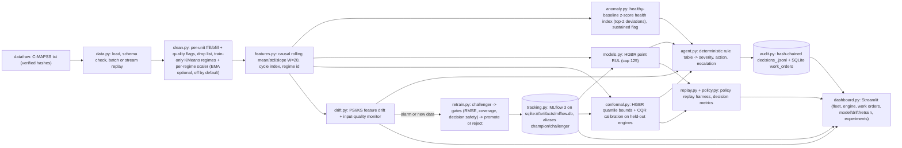

# SentinelLoop — System Design (Phase 2)

Status: PROPOSED (design); each component becomes VERIFIED when its tests and a fresh run pass (tracked in `PROJECT_STATUS.md`).

## 1. The operational problem and the decision we improve
A fleet operator must decide, for every machine every cycle, one of: do nothing, watch, schedule maintenance (MEDIUM/HIGH), stop the machine now (CRITICAL), or send a human to inspect because the evidence is not trustworthy. Standard student implementations (hypothesis from the prior-art search) compute a point RUL and threshold it. That ignores two things that decide whether the work order is right: **how uncertain the estimate is** and **whether the inputs can be trusted**. SentinelLoop makes the decision from the uncertainty lower bound and the input-quality/drift state, evaluates the decision policy (not just the regressor), retrains only through gates, and makes every action auditable.

## 2. Scope and non-goals
- In scope: NASA C-MAPSS FD001–FD004 (official train/test split), batch and replayed-stream ingestion, cleaning, rolling features, anomaly detection, RUL point + interval, deterministic Triage Agent, work orders, audit trail, MLflow tracking/registry, drift monitor, gated retraining, Streamlit dashboard, experiment harness.
- Non-goals: real telemetry connectors, CMMS integration, LLMs (forbidden by the PDF), deep sequence models in the critical path (allowed only as a logged challenger), cloud services, Kafka/PySpark.

## 3. Architecture

Data flow for one cycle in stream mode: raw row → clean (state per unit) → features (rolling state per unit) → anomaly score, RUL point, interval → drift/quality state → agent decision → audit record (+ work order create/update) → dashboard reads artefacts.

## 4. Components and interfaces

| Module (`src/sentinelloop/`) | Responsibility | Inputs → outputs | Key invariants |
|---|---|---|---|
| `config.py` | Load YAML config (`configs/default.yaml` + `configs/<subset>.yaml` override); fixed seeds | path → `Config` dataclass | All thresholds live in config, never in code |
| `data.py` | Download (S3 URL, ETag check) and load train/test/RUL; schema validation (26 columns, monotone cycles per unit); optional stream generator | subset → DataFrames with columns `unit, cycle, os1..os3, s1..s21` | Test labels are only read by `evaluate.py` |
| `clean.py` | Missing-value imputation within unit (ffill then bfill) with a per-row `n_imputed` flag; optional causal EMA denoise (disabled by default, D13); sensor drop list from TRAIN variance; KMeans(k) regime model on operating settings fit on TRAIN; per-regime StandardScaler fit on TRAIN | raw df → cleaned df + fitted `CleanState` (pickled) | Nothing is fit on test; EMA uses past values only |
| `features.py` | Causal rolling mean/std/slope (closed-form slope), `cycle`, `regime` | cleaned df → feature df + feature manifest | Window never looks ahead; identical code for batch and stream |
| `targets.py` | Train RUL = max_cycle − cycle, capped at `rul_cap`; test truth from RUL file (capped and raw) | — | Cap stated in every metric name |
| `models.py` | `HistGradientBoostingRegressor` point model; optional challengers (RandomForest, naive mean) | features → predictions | Seeded |
| `conformal.py` | Quantile HGBR (α/2, 1−α/2) + conformalized quantile regression calibration on held-out ENGINES with random truncations | → `lower, upper` | Calibration engines never used for training the point/quantile models |
| `anomaly.py` | Healthy-baseline z-score health index: RMS of the top-2 standardised deviations from the healthy phase (first `healthy_frac` of each train engine), armed after a warm-up window, names the deviating sensors; IsolationForest kept as an ablation (D10); sustained-flag logic (k consecutive cycles over threshold) | features → `anomaly_score, anomaly_flag` | Threshold = percentile of healthy train scores |
| `evaluate.py` | Official last-cycle metrics: RMSE (capped, raw), MAE, PHM08 score (convention printed), PICP, MPIW; engine-level GroupKFold with random truncation for validation | → `metrics.json`, `predictions.csv` | No test-set tuning anywhere |
| `drift.py` | Age-matched PSI per feature (early-life rows of the current fleet vs early-life rows of training engines; `cycle` never monitored); fleet drift share; critical operating-setting rule; severe single-feature rule (PSI > 1); input-quality monitor (missing, out-of-range vs the full training range, critical settings) | windows → `DriftReport`, `quality()` dict | Only feature drift is live; no KS test (PSI only) |
| `agent.py` | Pure function `triage(obs, thresholds) -> Decision`; severity ∈ {NONE, WATCH, MEDIUM, HIGH, CRITICAL}; `escalate_to_human` with reason codes; work-order create/update with one open order per unit | obs → `Decision` | Deterministic; unit-tested; thresholds tuned on validation engines only |
| `policy.py` | Policies for replay: A point-threshold, B point-minus-margin, C interval-lower-bound, D cost-tuned threshold | predictions → first-order cycle | All policies see identical inputs |
| `replay.py` | Cycle-by-cycle replay over complete trajectories (out-of-fold training engines) and over official test engines; decision metrics | → `policy_metrics.json` | Leakage-free: predictions are out-of-fold |
| `audit.py` | JSONL with a SHA-256 hash chain, one file per subset (`artifacts/audit/decisions_<subset>.jsonl`; a re-run of a subset starts its file afresh); `verify_chain()`, `replay_check()` re-derives every decision from its stored inputs and thresholds; the terminal hash and record count are written to `metrics.json` and the MLflow run as an external anchor | — | Detects in-place edits and reordering; not truncation by an insider (see threat model B7) |
| `tracking.py` | MLflow: params, metrics, data hash, feature manifest, model artifact; registered model `sentinelloop-<subset>`; aliases | — | SQLite backend; aliases only |
| `retrain.py` | `evaluate_gate` (RMSE tolerance, PICP floor, late-rate non-regression at the CRITICAL threshold); `run_retrain` = the retraining flow when new data arrives: `python -m sentinelloop retrain --subset X --new-data <C-MAPSS txt>` (or `--simulate-new-data`, or `--only-if-drift` to act only on a recorded drift alarm) trains a challenger on the stored gated champion's engines plus the new engines, gates it on held-out validation engines, promotes or rejects, logs to MLflow (`sentinelloop-<subset>-gated`) and `retrain_log.json`; E4 runs the scripted accept/reject/drift scenarios | — | Both outcomes demonstrated (E4, E4-secondary, `tests/test_retrain_flow.py`) |
| `stress.py` | Fault injectors: missing values, Gaussian noise, sensor bias shift, regime shift | df → corrupted df + ground-truth mask | Deterministic given seed |
| `stream.py` | `CleanStream` (per-unit forward fill, optional EMA, regime scaling) and `FeatureStream` (trailing-window mean/std/slope with the same numpy arithmetic as batch); `pipeline.run --stream-units N` replays the first N test engines cycle by cycle through them, with `StreamQuality` for window quality, and writes `decisions_stream.csv` and audit records tagged `mode=stream` | — | Stream predictions, flags and severities are bit-identical to batch on real data (`tests/test_pipeline_smoke.py`) |
| `dashboard.py` | Streamlit app reading artefacts | — | No computation in the UI beyond plotting |
| `cli.py` (`python -m sentinelloop`) | `doctor`, `data`, `baseline`, `run`, `retrain`, `audit`, `dashboard` (global `--data-dir`, `--out-dir`, `--config-dir`, relative to the current directory) | — | `run` = end-to-end without manual steps; experiments are scripts under `experiments/` |

## 5. Storage and artefacts
- `artifacts/<subset>/` : `metrics.json` (every metric, the config hash, data SHA-256 hashes, agent thresholds, decision outcomes vs truth, audit terminal hash), `predictions_test.csv` (last cycles) and `predictions_test_all_cycles.csv`, `decisions_test.csv` (batch decisions with quality/drift columns and top deviating features), `decisions_stream.csv`, `work_orders.json` (action, interval, due-by cycle, top sensors, reasons, model version), `conformal.json`, `anomaly.json`, `drift_reference.json`, `agent_thresholds.json`, `feature_manifest.json`, `retrain_log.json` (gate decisions of every named run: E4 primary, E4 secondary, `cli`), pickles consumed only by this package (`clean_state.pkl`, `model_point.pkl`, `model_cqr.pkl`, `anomaly.pkl`, `drift_monitor.pkl`, `gated_champion.pkl` after a `retrain`).
- `artifacts/baseline/<subset>/` : E0 baseline metrics and predictions (never overwrite the pipeline artefacts).
- `artifacts/mlflow.db`, `artifacts/mlruns/` : MLflow backend and artefact store; experiments `sentinelloop` (pipeline runs, registered model `sentinelloop-<subset>` with alias `champion`) and `sentinelloop-retrain` (gated models `sentinelloop-<subset>-gated`).
- `artifacts/sentinelloop.db` : SQLite tables `decisions`, `work_orders`, `runs`.
- `artifacts/audit/decisions_<subset>.jsonl` : one hash-chained audit log per subset.
- `artifacts/incoming/<subset>_new_engines.txt` : the simulated "new data" file written by `retrain --simulate-new-data`.
- `experiments/results/<exp>/` : `summary.json` (with `generated`, `seed`, `config_hashes`), `README.md` and CSV tables per experiment; `experiments/results/oof/` caches the out-of-fold tables.

## 6. Configuration
`configs/default.yaml` is the single source of truth (every threshold lives there; per-subset files override `clean.n_regimes`). Keys as shipped: `seed 42`, `rul_cap 125`, `clean.ema_alpha 0.0` (EMA off, D13), `clean.drop_sensor_std_threshold 0.001`, `features.window 20`, `model {max_iter 400, learning_rate 0.05, max_leaf_nodes 31}`, `conformal {alpha 0.10, calib_frac 0.30, truncations_per_engine 5}`, `anomaly {healthy_frac 0.4, threshold_pct 99, sustain 3, top_k 2}`, `agent {t_critical 10, t_high 25, t_medium 50, max_width auto, quality_max_imputed_frac 0.10, quality_max_out_of_range_frac 0.05, quality_max_critical_out_of_range_frac 0.5}`, `drift {psi_threshold 0.2, share_threshold 0.30, severe_psi_threshold 1.0, early_life_max_cycle 50, window 500 (used by E4's clean-window sampling only; the pipeline checks all early-life rows of the fleet)}`, `gate {rmse_tol 0.02, min_picp 0.85, max_late_rate_increase 0.02}`, `cv.n_folds 5`. The config hash of the run is stored in every `metrics.json` and every experiment `summary.json`.

## 7. Versioning and reproducibility
- Pinned `.venv` (`requirements.lock.txt`); seeds in config; data hashes logged to MLflow; `make doctor` checks environment and data.
- Every artefact names the subset, the config hash and the MLflow run id.

## 8. Deployment of the demo
Single machine, offline. `python -m sentinelloop run --subset FD001 --stream-units 5` produces all artefacts including the cycle-by-cycle stream replay of five engines; `python -m sentinelloop retrain --subset FD003 --simulate-new-data` shows the retraining flow; `python -m sentinelloop dashboard` serves Streamlit on localhost. A recorded clean-clone run (team action) is the fallback. Everything in `docs/DEMO_RUNBOOK.md`.

## 9. Known design limitations (stated in the deck)
C-MAPSS is simulated with one snapshot per cycle; no CMMS; residual drift only retrospective; conformal coverage is marginal over engines under an exchangeability assumption between calibration truncations and test truncations; cap-125 is a convention; cost figures in experiments are assumptions with sensitivity sweeps, never claims of real savings.
